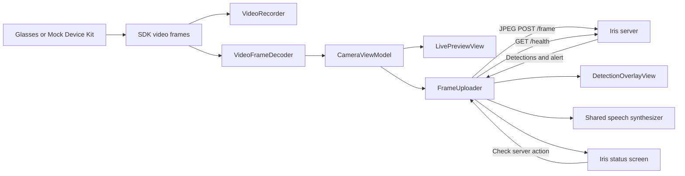

# Camera Access: frame uploading, camera lifecycle, and detection HUD

Date: October 17, 2026

Status: Specification of the current implementation; acceptance checks are required outcomes, not a claim that verification has passed.

## 1. Scope and ownership

This specification covers these four files and their integration with the Iris server:

| File | Responsibility |
| --- | --- |
| [FrameUploader.swift](app/CameraAccess/CameraAccess/Media/FrameUploader.swift) | Frame admission, JPEG preparation, uploads, response decoding, spoken alerts, server-health checks, and observable upload state. |
| [CameraViewModel.swift](app/CameraAccess/CameraAccess/ViewModels/CameraViewModel.swift) | Device/session/stream lifecycle, frame distribution, photo capture, recording, and synchronization of uploader activity. |
| [CameraView.swift](app/CameraAccess/CameraAccess/Views/CameraView.swift) | Camera preview, lifecycle controls, capture controls, presentation of errors and captured media, and entry to Iris status. |
| [DetectionOverlayView.swift](app/CameraAccess/CameraAccess/Views/DetectionOverlayView.swift) | Directional detection HUD over the local live preview. |

Supporting dependencies include `FrameUploadStatusView`, `WearablesViewModel`, `VideoFrameDecoder`, `VideoRecorder`, the Meta Wearables SDK, AVFoundation, UIKit, and SwiftUI. The existing project targets iOS 17.2 or later.

The network contract comes from [frame_routes.py](server/frame_routes.py), [auth.py](server/auth.py), [domain.py](server/domain.py), [alerts.py](server/alerts.py), [config.py](server/config.py), and [live_routes.py](server/live_routes.py). The original upload requirements and compatibility fixtures remain in [app-frame-uploader-spec.md](app-frame-uploader-spec.md) and [docs/contract](docs/contract).

## 2. System behavior and data flow

While a glasses or Mock Device Kit camera stream is active, the app displays decoded frames locally and, when the user enables uploading, submits approximately 2–3 frames per second to Iris. Successful replies update the directional HUD. Nonempty server alerts are spoken immediately.

The server owns detection filtering, alert thresholds, multi-frame confirmation, cooldowns, and same-side repeat limits. The app must preserve the server's alert decisions.



`CameraViewModel` owns one uploader. The camera view, HUD, and status screen must use that same instance. Camera and uploader observable state is isolated to the main actor; frame decoding, recording writes, and admitted-frame JPEG preparation occur away from the main actor.

## 3. FrameUploader.swift

### 3.1 Configuration and interfaces

`FrameUploader` is an `@Observable`, `@MainActor` class.

| Interface | Contract |
| --- | --- |
| `serverURL: String` | Editable server base URL, loaded from and saved to `UserDefaults` key `iris.serverURL`; defaults to an empty string. |
| `serverKey: String` | Editable API key, loaded from and saved to `UserDefaults` key `iris.serverKey`; defaults to an empty string. |
| `isEnabled: Bool` | User-controlled upload/speech toggle; starts `false` for each uploader instance. |
| `setStreaming(_:)` | Synchronizes eligibility with the actual camera lifecycle. |
| `submit(_ image: UIImage)` | Receives an already decoded frame and either admits it immediately or drops it. |
| `refreshServerHealth()` | Starts an explicit public health check, independently of uploading. |
| `hasFreshDetections(at:)` | Determines whether the HUD may display the current frame response. |

The initializer accepts injectable preferences, `URLSession`, speech implementation, and monotonic clock for testing. Production creates one reusable ephemeral session. Request and resource timeouts are both 1.5 seconds; connectivity waiting and URL caching are disabled; the configured maximum connections per host is one.

URL validation trims surrounding whitespace and requires HTTP or HTTPS with a nonempty host. Embedded username/password credentials, query parameters, and fragments are rejected. Endpoints are constructed by appending `frame` or `health` to the configured base path. Users must enter the base URL without an endpoint suffix.

API-key normalization must:

1. Trim surrounding whitespace and newlines.
2. Accept an empty result as an absent key.
3. Accept only printable ASCII scalar values `0x20...0x7E` in a nonempty result.
4. Reject an invalid key before image preparation or upload, using an error that does not contain the supplied value.

### 3.2 Frame admission and concurrency

A frame is eligible only when all of the following hold:

- Uploading is enabled.
- Streaming eligibility is true.
- No previous frame is being prepared, uploaded, or canceled.
- At least 400 ms have passed since the last admitted attempt, using the monotonic clock.
- The URL and API key are valid.

The uploader must drop ineligible frames immediately. It must not buffer frames, drain a backlog, or send bursts to catch up. At a 24 fps camera rate, the exact upload cadence depends on incoming frame times and request duration.

The upload slot is acquired before JPEG preparation and released when the task finishes. Cancellation must retain the occupied slot until cleanup completes, including during rapid off/on toggles or server changes. A generation identifier and cancellation checks must prevent outdated tasks from publishing detections, errors, timings, or speech.

### 3.3 Image preparation and request

| Property | Required value |
| --- | --- |
| Input | Decoded `UIImage` with positive, finite dimensions. |
| Output width | Exactly 640 pixels, including on Retina devices. |
| Output height | Aspect-ratio-preserving height rounded to the nearest integer, with a minimum of one pixel. |
| Maximum output side | 4096 pixels. A resized height above this limit is rejected before rendering/encoding. |
| Orientation | Normalized by drawing the source image into the output renderer. |
| Renderer | Scale `1`, opaque, standard dynamic range. |
| Encoding | JPEG, compression quality `0.7`. |
| Method and endpoint | `POST <base>/frame`. |
| Body | Multipart form data with exactly one field named `file`. |
| Filename / part type | `frame.jpg` / `image/jpeg`. |
| Maximum body | `2,000,000` bytes, including multipart headers, boundaries, and trailer; larger bodies are dropped locally. |
| Headers | Multipart `Content-Type`, `Accept: application/json`, and `X-Iris-Key` only for a nonempty normalized key. |
| Cache policy | Reload while ignoring local cache data. |

JPEG preparation runs in a utility-priority detached task and cooperates with cancellation. The 1.5-second networking timeout does not include time spent preparing the JPEG.

### 3.4 Frame response models

Only HTTP 200 is a successful frame reply.

`FrameDetection` contains:

| Field | Swift type | Meaning |
| --- | --- | --- |
| `label` | `String` | Server class name; future labels remain decodable. |
| `conf` | `Double` | Detection confidence, normally in the server's `0...1` range. |
| `side` | `String` | Usually `left`, `ahead`, or `right`; future directions remain decodable. |

`FrameResponse` contains:

| JSON field | Swift property/type | Behavior |
| --- | --- | --- |
| `detections` | `detections: [FrameDetection]` | Required; an empty array is valid. |
| `alert` | `alert: String?` | Null, missing, empty, or whitespace-only text produces no new speech. |
| `frame_id` | `frameID: Int?` | Optional diagnostics identifier. |
| `server_ms` | `serverMS: Int?` | Optional server processing time. |
| `description` | `description: String?` | Optional display-only scene description. |

Unknown JSON keys must be ignored. Labels and sides must remain strings rather than closed enums. Missing optional fields must not fail an otherwise valid response.

On success, replace detections and scene description, record the receipt date and round-trip time, update optional server diagnostics, and clear the current upload error. Quiet replies must preserve the previous alert text and its original receipt time.

Frame IDs can restart after a server restart. The app must continue accepting replies and alerts when an ID decreases; IDs are not a client-side alert deduplication mechanism.

### 3.5 Speech

`FrameAlertSpeaking` defines `speak(_:)` and `stop()`. Production uses one `AVSpeechSynthesizer` through `FrameAlertSpeaker`.

- Speak each nonempty `alert` returned by a successful frame response, including repeated strings when the server sends them again.
- Stop existing speech at `.immediate` before speaking a new alert.
- Preserve the existing audio-session configuration and use the current system audio route.
- Speak alert text only. Scene descriptions, health results, detections, and errors remain visual.
- Stop speech when the upload toggle, streaming state, URL, or key changes, and during uploader destruction.

### 3.6 Failure behavior

Image-preparation failures, non-200 responses, invalid HTTP responses, decoding errors, and transport errors must leave the camera running and allow a later eligible frame to retry.

| Condition | Upload error presentation |
| --- | --- |
| HTTP 400 | Server rejected the JPEG image. |
| HTTP 401 | Check server key. |
| HTTP 413 | Frame exceeds the server's upload limit. |
| HTTP 422 | Server rejected the frame form data. |
| HTTP 503 | Server model is not ready; check server health. This does not assume loading will succeed. |
| Other HTTP status | Fixed message containing the status number. |
| Timeout | Server unreachable: request timed out. |
| Other transport error | Fixed message directing the user to check URL and connection. |
| Invalid JSON | Fixed decoding-error message. |

HTTP error bodies and transport `localizedDescription` text must not enter uploader logs or UI: those values can echo credentials. Local image-preparation errors use controlled messages. Consecutive identical upload errors are logged only when the message changes.

A failed frame clears current detections, scene description, response date, round-trip time, server time, and frame ID. The historical alert and its date remain intact. Intentional cancellation must not become a new network error.

### 3.7 Public server-health checks

`refreshServerHealth()` sends `GET <base>/health` using the shared session, the same request timeout, and cache bypass. It sends no API key or query credentials, even when a key is configured or invalid.

Health checks are available while uploads and streaming are off. Only one health task may run at a time. One health task and one frame task may exist concurrently; the single-frame-upload rule still applies.

`IrisServerHealth` requires `ready: Bool` and `detector: String`. It optionally decodes `device`, `load_error`, `auth`, `fps`, `server_ms_p50`, `server_ms_p95`, `commit`, and `fallback`; other metadata is ignored.

Model-status precedence is:

1. `load_error` present → **Model failed to load**.
2. `ready == false` → **Model not ready**.
3. Empty detector name → **No detector reported**.
4. Otherwise → **Ready**.

A successful health request updates only health state and its check time. It must not authenticate the upload key, erase an upload authentication error, refresh the HUD, speak, or prevent frame retries based on stale readiness. Changing the server URL cancels and clears health state; changing only the API key retains the public health snapshot.

Health HTTP/decoding/network failures have separate fixed error messages. Outdated or canceled health requests must not publish results.

### 3.8 Observable state and invalidation

| State group | Properties |
| --- | --- |
| Activity | `isStreaming`, `isUploading`. |
| Current response | `detections`, `sceneDescription`, `lastResponseAt`, `lastRoundTripMS`, `lastServerMS`, `lastFrameID`. |
| Alert history | `lastAlert`, `lastAlertAt`. |
| Upload error | `lastError`. |
| Health | `serverHealth`, `isCheckingHealth`, `lastHealthError`, `lastHealthCheckedAt`. |

These properties are externally readable and privately set. Settings and `isEnabled` remain writable.

`statusText` evaluates in this order: **Off**, invalid URL, invalid key, **Waiting for live preview**, **Retrying**, then **Waiting for server** or **Uploading frames** according to whether a successful frame receipt exists.

Changing the toggle, streaming state, URL, or key invalidates current frame state, resets admission timing, requests upload cancellation, clears the upload error, and stops speech. Alert history is preserved. URL changes additionally invalidate health state.

## 4. CameraViewModel.swift

### 4.1 State and lifecycle

`CameraViewModel` is `@Observable` and `@MainActor`. It owns the device selector, SDK session, SDK camera, listener bags, recorder, decoder, and shared `frameUploader`.

Device monitoring updates availability; session creation requires a user action. SDK session and stream publishers remain the source of lifecycle state. Optimistic starting/stopping assignments make pending operations visible immediately.

| Action | Preconditions and required behavior |
| --- | --- |
| `startSession()` | Return if a session already exists. Create a session, subscribe before starting, and publish `.starting`. On failure, show the SDK error and return to idle cleanup. |
| `endSession()` | If a session exists, publish `.stopping` and stop it. SDK teardown cascades to the stream. |
| `startStreaming()` | Require a started SDK session and no existing camera. Query camera permission; start immediately when granted, otherwise request presentation of the redirect-confirmation alert. |
| `confirmCameraPermissionRedirect()` | Recheck that the session is started and no camera exists, request SDK permission, then begin streaming only when granted. |
| `stopStreaming()` | Prepare the recorder to stop, publish `.stopping`, and stop/detach the camera while retaining the device session. |

Stream configuration is HEVC `hvc1`, low resolution, and 24 fps. Listeners are installed before the stream starts. Stream termination clears listeners and camera references, sets `.stopped`, removes the preview frame, and clears the first-frame flag. Session termination clears session listeners and references.

### 4.2 Frame processing

Each SDK video frame follows this sequence:

1. Append its sample buffer to `VideoRecorder` away from the main actor; this is a no-op when recording is inactive.
2. Decode the compressed frame using `VideoFrameDecoder` away from the main actor.
3. On the main actor, when the app is not backgrounded and a decoded image exists, submit that image to the shared uploader.
4. Update `currentVideoFrame` and `hasReceivedFirstFrame` only when a capture preview is absent and photo capture is not in progress.
5. If recording has begun and the UI has no recording start date, read the recorder's actual first-frame start date.

Displaying a captured photo must not replace the image sent to Iris: uploads continue using arriving live frames. Glasses and Mock Device Kit frames use this same path.

Uploader streaming eligibility is exactly:

```swift
isSessionActive && isStreaming && UIApplication.shared.applicationState != .background
```

Both session-state and stream-state changes must recompute eligibility. Eligibility does not change the user's upload toggle.

### 4.3 Pause and background behavior

- A paused stream retains its most recent image for a frozen preview.
- Paused, stopping, and stopped streams make uploading ineligible, cancel pending uploads, stop speech, and clear current HUD data.
- Backgrounding always disables uploader streaming eligibility.
- If a session and attached stream exist and the session is not already stopping, backgrounding ends the session.
- Expected session/stream teardown errors are suppressed during background-driven stop. The suppression ends on session termination or after the configurable timeout, which defaults to five seconds.
- Returning to the app requires the normal session/preview controls; no automatic restart is specified.

### 4.4 Photo capture, recording, and errors

Photo capture requires a live stream and no photo already in progress. Capture requests use SDK JPEG photo capture. Immediate rejection clears the capture flag and presents the capture error. Receiving valid photo data clears the flag and opens a photo preview.

Recording starts only while streaming and when not already recording. The UI intent flag changes immediately; the writer starts on the next frame. Recording optionally includes the glasses microphone. If glasses audio is unavailable, the model switches the microphone setting off through the recorder callback.

Stopping a recording clears its UI intent and timer anchor, waits up to approximately 500 ms in 25 ms steps for a very short recording to start, and finalizes the recorder. A completed file opens a video preview; absent/failed recordings present an error. A paused stream must still allow an existing recording to stop.

`CapturePreview` represents either an in-memory photo or a video URL. Dismissing a video preview attempts to remove its temporary file. Recording elapsed time uses the actual recorder start date and formats as `mm:ss`.

SDK/capture failures use `showError` and `errorMessage` for the camera's alert presentation. Upload and health failures stay in uploader state and do not trigger camera teardown or the SDK error alert.

## 5. CameraView.swift

### 5.1 Ownership and presentation

`CameraView` creates and retains its `CameraViewModel` using `@State`, and binds the supplied `WearablesViewModel`. It must pass `viewModel.frameUploader` to both the HUD and `FrameUploadStatusView`.

The screen contains:

- A full-bleed preview or dark placeholder.
- `DetectionOverlayView` directly over `LivePreviewView`.
- A dimmed paused state with instructions to tap the glasses to resume.
- A loading scrim during session/stream transitions.
- Top lifecycle indicators and app controls.
- Bottom preview, capture, recording, microphone, and session controls.
- A foreground captured-media preview when `activePreview` is set.
- A sheet for Iris status and alerts for SDK errors and camera-permission redirection.

`LivePreviewView` isolates frequent image updates from surrounding controls. It displays the image with aspect-fill and clipping once the first frame has arrived; otherwise it shows progress. Pausing or stopping can retain the final frame while the lifecycle converges.

Placeholder precedence is: no active device, firmware update required, no session, paused, then session ready for preview. Loading transitions take precedence over ordinary placeholders.

### 5.2 Controls and enablement

| Control | Behavior and enablement |
| --- | --- |
| Session button | Start a session when absent; end it when present. Starting requires an active device. Pending transitions disable the button. Position remains stable across states. |
| Preview | Starts or stops the preview according to active-preview state. Disabled during transitions and while recording. Starting requires an active session. Paused-stream resumption follows the glasses gesture. |
| Photo | Enabled while streaming; delegates capture guards to the view model. |
| Record / Stop | Starting requires streaming. Stopping remains enabled while recording, including when paused. |
| Microphone | Enabled while streaming and not recording. Toggles glasses audio; when permission is denied, opens iOS Settings. |
| Iris status | Waveform button opens the status sheet using the shared uploader. |
| Settings | Opens the Disconnect control; an outside tap dismisses the menu. |
| Update firmware | Displays when required, launches the SDK update flow, and stays disabled while launch is pending. |

The capture row retains its layout space while hidden without a session. The recording timer updates independently through a periodic timeline. Session/stream chips display the SDK state with active/present/inactive indicators.

### 5.3 Accessibility hooks

Stable identifiers include `iris_status_button`, `settings_button`, `start_session_button`, `end_session_button`, `start_preview_button`, `stop_preview_button`, `capture_button`, `record_button`, `mic_toggle`, `recording_indicator`, `paused_overlay`, and `update_firmware_button`. The Iris button's accessibility label is **Iris status**.

## 6. DetectionOverlayView.swift

The HUD consumes the shared uploader's observable state. It has no independent networking, alert policy, or speech synthesis.

Rendering is allowed only when `hasFreshDetections(at:)` is true:

```text
uploads enabled
AND streaming eligible
AND a successful frame response exists
AND 0 <= current date - response receipt date < 2 seconds
```

A timeline reevaluates freshness every 0.5 seconds. Thus an unchanged stale display is removed on the next timeline tick; exact wall-clock disappearance can occur up to roughly half a second after the two-second freshness boundary. Normal observable updates can hide it sooner.

HUD presentation requirements:

- Three equal-width directional columns in left, ahead, right order, using `arrow.left`, `arrow.up`, and `arrow.right` symbols.
- Show a column's badge only when it has detections.
- Display every returned detection in that column, including duplicate labels; capitalize labels and format confidence as a percentage with no fractional digits.
- Use readable white text, yellow directional accents, and dark translucent rounded backgrounds.
- Display detections with unrecognized side strings in a separate textual group, retaining the raw side text.
- Empty detections produce no detection badges.
- Allow touches to pass through to camera controls.
- Combine directional-column accessibility content and expose `detection_overlay` with label **Live server detections**.

The HUD uses directions from this phone's own `POST /frame` replies. The server's `/latest` boxes belong to a saved server JPEG and can reflect another uploader or replay. They are not geometrically registered to the current local frame. API usage for these four files is limited to frame uploads and explicit health checks; the browser live-view endpoints and event history remain separate.

## 7. Deployment dependencies

- Register the Swift source files in the application target and make contract JSON fixtures available to tests.
- Provide `NSAppTransportSecurity → NSAllowsLocalNetworking = YES` for local HTTP development, plus a local-network usage description covering glasses connectivity and Iris frame uploads.
- Configure the server address through the UI; provide the API key when the server reports authentication enabled.
- Production speech uses the current audio route, so phone-speaker and glasses/Bluetooth behavior require device verification.

## 8. Acceptance checks

| ID | Scenario | Required result |
| --- | --- | --- |
| A01 | Launch or construct a new uploader. | Upload toggle is off; saved URL/key load; no frame is sent. |
| A02 | Enable uploads with a live glasses or mock stream and a responsive server. | Approximately 2–3 JPEG frame requests per second; no overlapping frame tasks or queued bursts. |
| A03 | Inspect a request produced from a Retina/oriented image. | One multipart `file` part, JPEG quality configured to `0.7`, 640-pixel width, correct aspect/orientation, and body within the complete-body limit. |
| A04 | Submit images whose resized heights are 4096 and 4097 pixels. | Boundary image is eligible; oversized image is rejected locally; a subsequent valid frame can upload. |
| A05 | Use a whitespace-only key, a key with trailing newline, and keys with embedded controls/non-ASCII characters. | Blank key omits the header; surrounding whitespace is trimmed; invalid keys prevent frame requests and never appear in errors. |
| A06 | Decode all three existing `/frame` contract fixtures and future labels/directions. | Optional fields and unknown keys are accepted; current required data retains its meaning. |
| A07 | Receive alert, quiet, and repeated-alert replies. | Speak only nonempty alerts; preserve alert history on quiet frames; repeat server-requested speech without local cooldowns. |
| A08 | Receive 400, 401, 413, 422, 503, invalid JSON, and transport failures. | Show the appropriate fixed error, clear current frame/HUD data, continue streaming, and recover on a later valid response. |
| A09 | Put credentials in an HTTP error body or transport error description. | Credentials do not appear in uploader UI/log messages. |
| A10 | Disable/re-enable rapidly, change settings, pause, stop, or background during an upload. | Cancel stale work, stop speech, prevent stale publication, and keep the upload slot occupied until cancellation completes. |
| A11 | Check health while uploads are off or the configured upload key is invalid. | Public `GET /health` succeeds when available, carries no key, and changes only health state. |
| A12 | Receive healthy, model-loading, and model-load-failed health responses. | Show the defined model status; public health success does not clear a frame-authentication error or gate future uploads. |
| A13 | Change the server URL during a held health request. | Cancel/ignore the old result; the next check uses the replacement URL. |
| A14 | Restart the server so frame IDs decrease. | New replies and server alerts continue to be accepted. |
| A15 | Let HUD data age, then perform a health check. | HUD expires according to its frame-response timestamp; health does not extend freshness. |
| A16 | Pause the stream during recording. | Retain the frozen preview and pause instructions; disable uploads; allow recording to stop and finalize. |
| A17 | Display captured media while live frames continue. | Preview remains stable while the uploader receives actual arriving live images. |
| A18 | Background an active preview session. | Disable uploads immediately and end the session, with bounded suppression of expected teardown errors. |
| A19 | Open Iris status and interact with camera controls under the HUD. | Status uses the same uploader; the HUD does not intercept taps. |
| A20 | Build and run the integration checks with a correctly configured Wearables SDK. | Application builds; uploader contract tests and camera lifecycle tests pass; physical-device speech and recovery checks succeed. |

## 9. Verification status

The initial application version previously passed a simulator build. The most recent server-alignment edits add key validation, redacted errors, the image-side limit, public health checks, and centralized HUD freshness. Their requested build/test run was interrupted before execution, so they are awaiting verification.

The existing app-hosted test attempt previously failed during Wearables SDK configuration, before tests ran. A temporary host can run uploader tests independently of that startup path. This document defines acceptance for the current source; it does not mark those checks complete.
