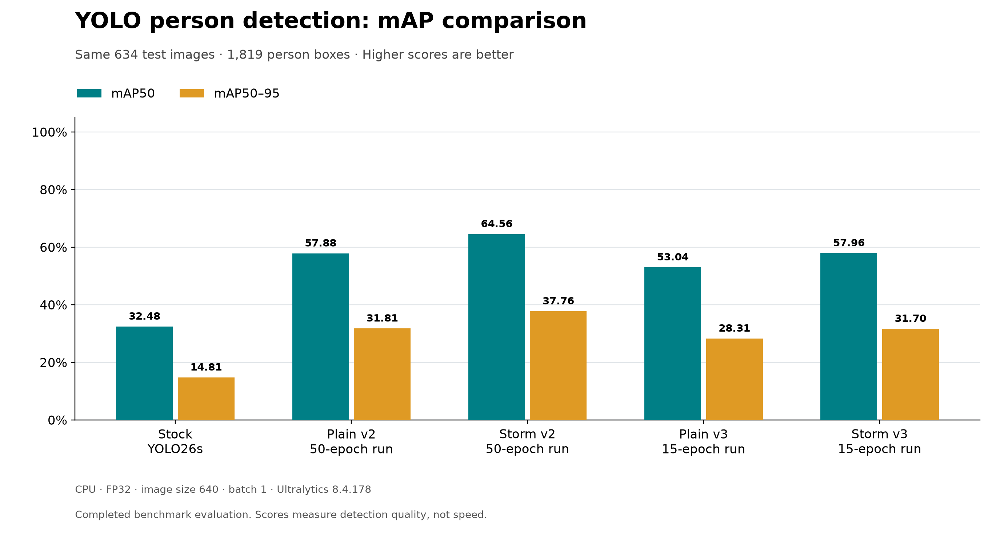
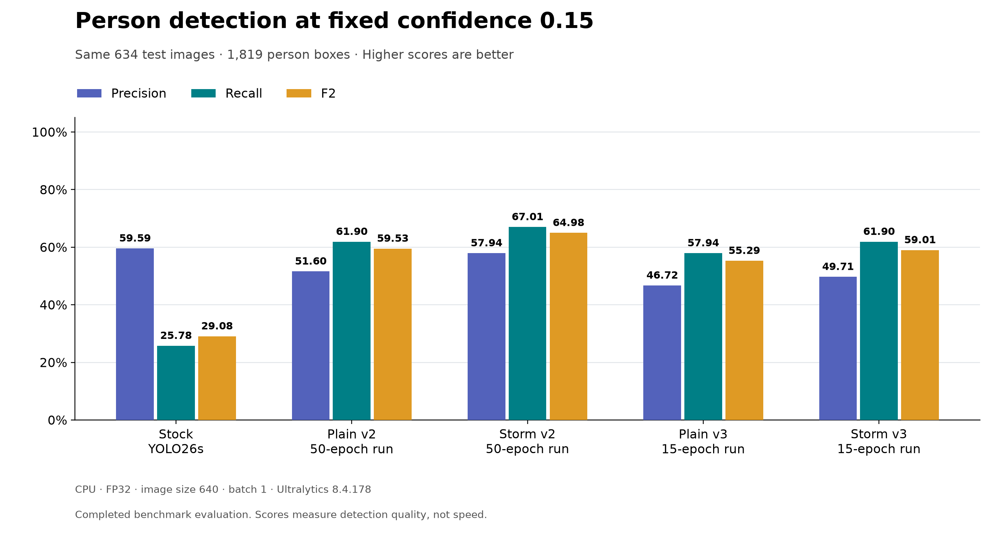

# V3 model comparison

Both supplied v3 weights are YOLO26s person detectors with 15 recorded epochs. All 634 image and annotation hashes match the v2 benchmark. Stock/v2 scores are reused from the existing matching-protocol evaluation; only v3 inference was rerun.

## mAP comparison

| Model | mAP50 | mAP50-95 | AP-summary precision | AP-summary recall |
| --- | ---: | ---: | ---: | ---: |
| yolo26s | 32.48% | 14.81% | 49.02% | 31.12% |
| best_plain_v2 | 57.88% | 31.81% | 72.51% | 53.77% |
| best_storm_v2 | 64.56% | 37.76% | 76.77% | 60.31% |
| best_plain_v3 | 53.04% | 28.31% | 66.12% | 49.20% |
| best_storm_v3 | 57.96% | 31.70% | 71.72% | 53.49% |

## V3 changes relative to v2

- **Plain:** mAP50 -4.85 percentage points; mAP50-95 -3.49 percentage points.
- **Storm:** mAP50 -6.60 percentage points; mAP50-95 -6.06 percentage points.

These are measured benchmark differences, not proof of an epoch-only causal effect. Both v3 checkpoints record `resume=false` and base `yolo26s.pt`: these were fresh 15-epoch runs. Compared with v2, recorded patience changes from 10 to 5 and dropout from 0.0 to 0.1, alongside run names and training package version (8.4.181 to 8.4.182). Dropout is classification-only in the installed evaluator; no dropout module effect on these detectors is established. The team reported using the same training datasets.

## Fixed confidence comparison

Every model uses confidence **0.15**, chosen before viewing v3 results. This includes stock; the earlier stock operating-point table used 0.05, so its numbers differ. No v3 threshold sweep or optimization was performed.

| Model | Precision | Recall | F2 | Matched boxes | Unmatched predictions | Missed boxes |
| --- | ---: | ---: | ---: | ---: | ---: | ---: |
| yolo26s | 59.59% | 25.78% | 29.08% | 469 | 318 | 1350 |
| best_plain_v2 | 51.60% | 61.90% | 59.53% | 1126 | 1056 | 693 |
| best_storm_v2 | 57.94% | 67.01% | 64.98% | 1219 | 885 | 600 |
| best_plain_v3 | 46.72% | 57.94% | 55.29% | 1054 | 1202 | 765 |
| best_storm_v3 | 49.71% | 61.90% | 59.01% | 1126 | 1139 | 693 |

## Interpretation and artifacts

- AP protocol: CPU, FP32, eight threads, image size 640, batch 1, candidate floor 0.001, NMS IoU 0.7, no augmentation, Ultralytics 8.4.178. V3 load/inference succeeded despite its newer recorded training version.
- Fixed metrics use confidence-order one-to-one matching at IoU 0.5 against the same 1,819 boxes. Unmatched predictions are relative to available labels, not independently verified false alarms.
- These charts report completed detection-quality measurements on the 634-image benchmark. They do not measure a speed improvement; CPU timing excludes phone upload and speech.
- [Comparison CSV](V3_MODEL_COMPARISON.csv), [compact JSON](V3_MODEL_COMPARISON.json), and [fresh v3 AP CSV](results_v3.csv).
- mAP: [PNG](figures/map_comparison_v3.png), [SVG](figures/map_comparison_v3.svg), [PDF](figures/map_comparison_v3.pdf).
- Precision/recall/F2: [PNG](figures/operating_point_comparison_v3.png), [SVG](figures/operating_point_comparison_v3.svg), [PDF](figures/operating_point_comparison_v3.pdf).
- Raw predictions, recovered histories, full checkpoint metadata and input-reference checks are under `runs/post_training_v3/` (shared separately). Existing v2 weights, charts and CSVs were preserved. No running server configuration was changed.
