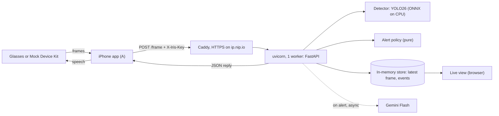
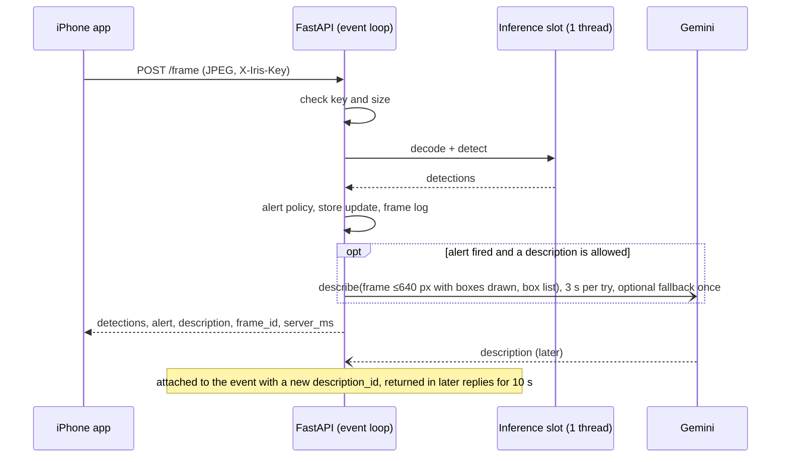

# Iris server and infra: system design

Owner: Person B · Status: draft, input for `/grill-with-docs` · Oct 16, 2026

This doc covers everything B owns: the FastAPI server, alert logic, live view, Gemini descriptions and the Vultr deploy. It is written to be grilled, turned into a spec with `/to-spec`, and split into tickets with `/to-tickets`. Section 14 lists the tickets, section 15 covers small PRs and reverts, and section 16 covers how to run the tickets through the agent workflow.

## 1. Summary

- One FastAPI process, one uvicorn worker, all state in memory. No database.
- Only inference leaves the event loop. It runs in a single worker-thread slot, and all state changes happen back on the event loop, so state has exactly one writer and needs no locks.
- The alert policy is a pure function. It fires on 2 hits in the last 3 frames, with a 4 s cooldown and a 10 s same-side repeat limit. It is tested only through `POST /frame`, using a fake detector and a fake clock.
- **Spoken descriptions.** When an alert fires and a description is allowed, one background Gemini call returns one sentence about the scene (text only), and the app speaks it with the phone's voice about 1 to 2 s later. The short alert is display-only: the app shows it but doesn't speak it (#44). The alert never waits on Gemini, and with Gemini down it still shows on screen and in the live view.
- Every single point of failure has a fallback (section 12):
  - systemd restarts the server if it crashes.
  - A deploy rolls back if the health check fails.
  - The app fails over to the laptop URL.
  - Bad weights fall back to the stock model.
- Serving runs on a Vultr Dedicated CPU instance (8 vCPU, about $0.24/hr, so roughly $10 for the whole event) with YOLO exported to ONNX, behind Caddy with automatic HTTPS on a `nip.io` hostname. Vultr's GPU plans in the console are either unavailable or far over budget. The laptop is a fallback, one URL change away in the app.

## 2. Priorities and non-goals

This is a hackathon server: one phone, one server, about 36 hours. When two choices conflict, the higher priority wins.

1. **Working.** The `/frame` contract works at every checkpoint. Alerts feel right: about a second from a person appearing to speech, with no spam.
2. **Resilient and reliable.** It stays up through judging, recovers from crashes on its own, and every single point of failure has a fallback you have practiced (section 12, "Failure modes").
3. **Secure.** Nothing reachable from the internet can be abused cheaply: no open write endpoints, no plaintext traffic, no leaked keys (section 12, "Security checklist").
4. **Fast.** Frame to speech under 1 s over cellular, and nothing slow on the frame path.

Supporting goals: tune thresholds without rebuilding the app or restarting the server, and produce real numbers for the pitch (server latency, end-to-end latency, alerts per clip).

**Non-goals**

- **Scale.** One phone streams at a time, so there is one alert stream, and that assumption is recorded as an ADR. No load balancing, autoscaling or multiple workers.
- Persistence beyond log files, user accounts, and horizontal scaling.
- Object tracking (ByteTrack). This can be revisited after hour 16 if the 2-of-3 window still spams.
- Training. That belongs to C.

## 3. API contract

The team plan's contract is unchanged. This design only adds optional fields and one header. iOS `Codable` decoding ignores keys it doesn't know, so the added fields can't break A's app. A must still agree to the header, because the team rule is to talk before any contract change.

### `POST /frame`

The request is multipart, with a field `file` holding a JPEG (640 px wide, quality 70). The `file` part may or may not carry a filename; the server reads its raw bytes either way.

**New:** if the server has `IRIS_API_KEY` set, the request must carry an `X-Iris-Key` header. Leave the key unset for local dev.

Response `200`:

```json
{
  "detections": [{"label": "person", "conf": 0.71, "side": "left"}],
  "alert": "possible person, left",
  "description": null,
  "description_id": null,
  "frame_id": 1842,
  "server_ms": 38
}
```

| Field | Status | Meaning |
| --- | --- | --- |
| `detections` | contract | Boxes at or above `CONF_DETECT` with an alert label. `side` is `left`, `ahead` or `right`. |
| `alert` | contract | The short alert text, or `null`. The server owns every rule behind it. The app shows it on screen and doesn't speak it (section 8). |
| `description` | new, optional | Gemini's one sentence for the latest event less than 10 s old, else `null`. The app **speaks** it, once per new `description_id` (section 8). Descriptions are the only thing the app speaks. |
| `description_id` | new, optional (ticket 08) | Integer, unique per description and increasing. `null` whenever `description` is `null`. The app speaks a description only when this id is new. |
| `frame_id` | new, optional | Increments per frame. Lets A match app logs with server logs. |
| `server_ms` | new, optional | Time from receiving the upload to the response being ready. A subtracts it from the round trip to get network time. |

`description_id` ships with ticket 08, which also adds it to `frame-extended.json`. Until then the server never sends it. Both fields are additive: an app that doesn't know them ignores them, and `alert` keeps working without them.

Errors use FastAPI's `{"detail": "..."}` shape. The app should treat any non-200 response as "no alert" and keep streaming.

| Code | When |
| --- | --- |
| 400 | The body is not a decodable image, or its sides are larger than 4096 px. |
| 401 | The key is missing or wrong, when a key is configured. |
| 404 | Wrong path, such as `/frame/frame`. Clients treat it like any non-200. |
| 405 | Wrong method, such as GET on `/frame`. |
| 413 | The body is over 2 MB. |
| 422 | Any request that fails validation: no `file` part, a body that is not valid multipart, or a bad query value. `detail` is a short string naming the field and reason, never request data. If `file` appears twice, the first wins. |
| 503 | The model hasn't finished loading yet. |

When Caddy itself rejects a chunked body over 2 MB, its 413 has an empty body, not `{"detail": ...}`. Clients must not depend on error bodies; the app already ignores them.

### Keeping the app and server compatible

Either side's PRs must be revertable without breaking the other side.

- **Fixtures are the contract.** `docs/contract/*.json` holds example replies. Server tests check that real replies match their shape, and A can decode the same files in a Swift unit test. A contract change means changing a fixture, labeled as a contract change and reviewed by A.
- **Additive only.** The server can add optional fields, headers or endpoints. It never renames or removes any.
- **Tolerant reader in Swift:**
  - Decode `label` and `side` as `String`, not as a strict `enum`. If C adds a class like `limb`, a strict enum would fail to decode the whole reply, and alerts would go silent.
  - Make every new field `Optional`.
  - Treat a decode failure the same as a non-200: no alert, log it, keep streaming.
  - `frame-extended.json` includes an unknown `future_field` to prove this works.
- **Order cross-side changes as expand, then contract:**
  - A new field in the reply ships on the server first. The app starts reading it later.
  - A new requirement on the request, like the key header, ships in the app first. The server enforces it later, by setting `IRIS_API_KEY`.
  - Done in that order, reverting either step leaves both sides working.

### Other endpoints

| Method and path | Auth | Purpose |
| --- | --- | --- |
| `GET /health` | none | Readiness, active model, device, labels, image size, fps, server ms p50/p95, commit, tuning, `describe` (`on` or `off`, the effective state) and `gemini_model` (the main model when on, else `null`; never the key). p50/p95 cover the last 100 frames within 60 s and are null when none are in that window |
| `GET /` | key, as `?key=` | Live view page |
| `GET /latest.jpg` | key, as `?key=` | The last frame received, as raw JPEG |
| `GET /latest` | key, as `?key=` | `frame_id`, detections with normalized boxes, the time the frame arrived, `age_ms`, `boot_id`, and an optional `stale` (true once the published frame is more than 3 s old; `detections` is then empty) |
| `GET /events?since=<id>` | key, as `?key=` | Recent events: id, `at` (wall-clock UTC, ISO 8601), side, conf, description |
| `GET /tuning` | none | The current tuning values |
| `PUT /tuning` | key | Ticket 09, **cut**: not built. It was to change tuning at runtime. Change settings in `/etc/iris.env` and restart instead. |

The live view endpoints (`/`, `/latest.jpg`, `/latest` and `/events`) show the camera feed, so when `IRIS_API_KEY` is set they require the same key as a `?key=` query parameter. Open the live view at `/?key=<key>`; the page passes the key along on its own polls. With the key unset, as in local dev, everything stays open. `/health` and `GET /tuning` stay open, since they don't show the feed and `update.sh` and the preflight check need `/health`. This changes nothing for A.

## 4. Glossary

These terms are candidates for `GLOSSARY.md`; `/grill-with-docs` should settle them.

- **Frame**: one JPEG the app posts to `/frame`.
- **Detection**: one box from the detector, kept only if its label is an alert label and its conf is at least `CONF_DETECT`.
- **Hit**: a detection with conf at least `CONF_ALERT`. A **hit frame** has at least one hit.
- **Window**: the hit flags of the last `WINDOW` frames received within `WINDOW_MAX_AGE_S`.
- **Side**: `left`, `ahead` or `right`, from which third of the frame the box center falls in.
- **Alert policy**: the rules that turn the window into an alert.
- **Alert**: the text returned in `alert`.
- **Cooldown**: the minimum time between any two alerts.
- **Same-side repeat**: the minimum time between two alerts on the same side.
- **Event**: the record of a fired alert: id, time, side, conf, frame and, later, a description.
- **Description**: Gemini's one sentence about the frame that fired an event, covering every kept box, grouped by side. It is the only thing the app speaks.
- **Description id**: an increasing integer per description, so the app speaks each description once.
- **Described scene**: the boxes (side, center, area) of the last attached description and when it was attached. It is forgotten when the frame stays empty for `DESCRIBE_EMPTY_RESET_S`. An alert's scene is new when it differs from the described scene by count, sides, a large move or resize, or age (section 8).
- **Detector**: an adapter from an image to detections. YOLO is one, and D's zero-shot model is another.
- **Describer**: an adapter from a frame with its boxes drawn on, plus a line listing each box's side and conf, to a description (Gemini).
- **Tuning**: the alert policy parameters that can change at runtime.
- **Live view**: the browser page showing the latest frame, boxes and the event log.
- **Replay harness**: a script that streams a video clip to the server the way the app does.
- **Sighting**: a stretch of clip time when a person is visible, marked by hand (by D) for checking alerts. Not to be confused with the window; avoid "time window" for it.

## 5. Architecture



### Module map

The team plan gives B `main.py`, `config.py` and `gemini.py`. This design proposes that B owns all of `server/` except `zeroshot.py` (D) and `weights/` (C). Update the plan's ownership table when you agree on that.

| Module | Responsibility | Depends on |
| --- | --- | --- |
| `server/domain.py` | Types: `Box`, `Detection`, `Side`, `Event`, `Tuning`, `PolicyState` | stdlib only |
| `server/alerts.py` | Alert policy: `decide(state, detections, now, tuning) -> (state, alert or None)` | `domain` |
| `server/detector.py` | `Detector` protocol, the YOLO adapter (device, warmup, normalized boxes), and the zero-shot adapter that wraps D's `zeroshot.detect` | `domain`, ultralytics |
| `server/zeroshot.py` (D) | A plain function `detect(image) -> list[dict]`, each dict holding `label`, `conf` and a normalized `box`. It never imports B's code. | transformers |
| `server/gemini.py` | `Describer` protocol, plus the Gemini adapter (prompt from `prompts/describe.txt`, timeout) | google-genai |
| `server/prompts/describe.txt` | System instruction and few-shot examples for descriptions; `GEMINI_PROMPT_FILE` overrides the path | |
| `server/store.py` | Latest frame snapshot, event ring buffer (200 events), rolling latency stats, JSONL logs | `domain` |
| `server/pipeline.py` | Per frame: decode and detect in the worker slot, then policy, store and describe on the loop | everything above |
| `server/config.py` | `Settings`, parsed from the environment once at startup | pydantic-settings |
| `server/routes/*.py` | Thin HTTP layer: `frame`, `live`, `admin` (tuning) | `pipeline`, `store` |
| `server/main.py` | `create_app(detector, describer, clock, settings)`, lifespan, router wiring | all |
| `server/static/live.html` | Live view: polls `/latest`, `/latest.jpg` and `/events`, draws boxes on a canvas | HTTP only |
| `server/scripts/replay.py` | Replay harness | HTTP only |
| `deploy/` | `bootstrap.sh`, `update.sh`, `iris.service`, `Caddyfile` | |

Rule: `domain`, `alerts` and `store` never import FastAPI, ultralytics or genai. Validation and parsing happen at the boundaries (`routes`, `config`, adapters). Inside them, code trusts its types.

Run commands from `server/` (`uvicorn main:app`), as in the team plan, so D's `zeroshot.py` imports as a sibling module.

### Type shapes

These came from a prototype of the policy that passes every scenario in section 13.

```python
Side = Literal["left", "ahead", "right"]

@dataclass(frozen=True)
class Box: x1: float; y1: float; x2: float; y2: float   # normalized 0..1

@dataclass(frozen=True)
class Detection: label: str; conf: float; box: Box      # side is derived from box center x

@dataclass(frozen=True)
class Tuning:
    conf_alert: float = 0.20; window: int = 3; needed: int = 2
    cooldown_ms: int = 4000; same_side_repeat_ms: int = 10000; window_max_age_ms: int = 2000

@dataclass(frozen=True)
class PolicyState:
    recent: tuple[tuple[int, bool], ...] = ()            # (t_ms, hit) pairs
    last_alert_ms: int | None = None
    last_alert_side: Side | None = None

class Detector(Protocol):
    name: str
    def detect(self, image: np.ndarray) -> list[Detection]: ...

class Describer(Protocol):
    async def describe(self, jpeg: bytes, boxes: str) -> str: ...  # boxes drawn on jpeg, listed in boxes

class Clock(Protocol):
    def now_ms(self) -> int: ...                          # monotonic integer milliseconds

class WallClock(Protocol):
    def now(self) -> datetime: ...                        # UTC, for display and logs only
```

`Tuning` validates `1 <= needed <= window` and `0 < conf_alert <= 1`, both at startup and on `PUT /tuning`. That makes an impossible policy unrepresentable.

**Time is integer milliseconds inside the server.** With float seconds, the worked scenarios that land exactly on a limit go wrong: in Python, 0.4 added eleven times minus 0.4 is `3.9999999999999996`, so a 4 s cooldown would still be running at 4.4 s. Environment variables and `/tuning` stay in seconds and are converted to ms when they are parsed.

**Two clocks.** The alert policy reads only the monotonic `Clock`. Every event and log line also records `at`, a wall-clock UTC timestamp from `WallClock`, so the live view and A's app logs can be lined up. `at` is never used in a decision.

## 6. Frame lifecycle



1. **Auth.** If a key is configured, compare `X-Iris-Key` against it with `hmac.compare_digest`. Return 401 if it doesn't match.
2. **Size.** Caddy caps request bodies at 2 MB and the app enforces the same limit again, returning 413.
3. **Decode and detect** run in a worker thread through `anyio.to_thread.run_sync` with a `CapacityLimiter(1)`. The model is a real single-writer resource, so that's the one place work is serialized. Decoding uses `cv2.imdecode`; a failure, or a side over 4096 px, returns 400. The pipeline, not the adapter, then keeps only detections whose label is in `ALERT_LABELS` (just `person` for the stock COCO model) and whose conf is at least `CONF_DETECT`. That keeps the filter testable with a fake detector.
4. **Side** comes from the box center x: left if below 1/3, right if above 2/3, otherwise ahead.
5. **Alert policy** runs on the loop (section 7).
6. **Store**: replace the latest-frame snapshot (raw JPEG bytes, detections, frame_id, `t_ms`, `at`), update the latency stats, and append one line to `logs/frames.jsonl`. If an alert fired, append an event to the ring buffer and to `logs/events.jsonl`.
7. **Describe**: if an alert fired and a description is allowed (section 8: none in flight, describe cooldown over, scene new), draw every kept box on the frame and start a background task. Hold a reference to the task in a set so it isn't garbage-collected. On success, write the description and a new `description_id` onto that event, unless the answer is stale or a newer alert has fired. Every frame also updates the empty-frame timer that can forget the described scene. The event loop is still the only writer.
8. **Respond** with the latest event's description and `description_id` if the event is less than 10 s old.

**Why it's built this way:** an `async def` route that called the model directly would block the event loop, which is exactly what `fastapi-reviewer` flags. A plain `def` route runs in a thread pool, and then state would have many writers. Sending only the blocking call to one slot avoids both problems.

### Latency budget

These are estimates. Measure them with the replay harness and `/health`.

| Step | Laptop on LAN | Vultr over cellular |
| --- | --- | --- |
| App resizes and encodes the JPEG (A) | 10–20 ms | 10–20 ms |
| Upload of about 50 KB | 20–50 ms | 100–300 ms |
| Decode | ~3 ms | ~3 ms |
| YOLO26s at 640 | Laptop GPU: well under 20 ms | Vultr CPU with ONNX: about 90–150 ms |
| Policy, store, serialize | <1 ms | <1 ms |
| Reply and start of speech | 50–100 ms | 100–200 ms |
| **Frame to speech** | **< 0.3 s** | **< 0.8 s** |

**Speed rules:**
- **Reuse one connection.** A uses a single `URLSession` for every upload, so the connection and TLS handshake are set up once. A new handshake per frame would add 100–300 ms over cellular.
- **Small uploads.** Frames stay at about 50 KB.
- **Nearby server:** Atlanta region.
- **Warm model.** The model warms up at startup, so the first frame isn't slow.
- **Nothing slow on the frame path.** Gemini runs in the background, boxes are drawn in the browser, and the server writes one log line per frame.

The first alert can't fire before the second hit frame, about 0.4 s after the first at 2.5 fps. So a person entering view is announced roughly 1 s later on the LAN, and a bit more over cellular.

## 7. Alert policy

These rules are exact; the tests in section 13 come from them.

1. A **hit** is a detection with an alert label and conf at or above `conf_alert`.
2. The **window** is the last `window` frames whose timestamps are within `window_max_age_s` of now, including the current frame. Older entries are dropped, so hits from before a pause in the stream don't count.
3. An alert fires only on a hit frame, and only when the window holds at least `needed` hits.
4. It is suppressed if the time since the last alert is under `cooldown_s`.
5. It is also suppressed if the time since the last alert is under `same_side_repeat_s` and the side is the same as last time.
6. The side is the side of the highest-confidence hit in the current frame. The window counts hit frames regardless of side, so a hit on the left followed by a hit on the right fires on the right (scenario 14).
7. The text is `possible person, <side>` for every alert label.

**Changes from the team plan**

- **2 of the last 3 frames** instead of 2 in a row. At 2.5 fps, a single dropped detection, from a head turn or a raindrop, would otherwise reset the streak. The plan's rule is still available as `needed = window = 2`.
- **Same-side repeat.** Without this, a person who stays in view gets announced every 4 s. A new person on another side is still announced after the 4 s cooldown.
- **Server clock**, read through an injected monotonic `Clock` in integer ms. The phone's clock is never used.

The defaults are starting points. Tune them in `/etc/iris.env` on the box and run `systemctl restart iris`; runtime tuning (ticket 09) is cut.

## 8. Gemini descriptions (spoken)

About 1 to 2 s after an alert, the rescuer hears one sentence from Gemini about the scene, read aloud by the phone's Apple voice (`AVSpeechSynthesizer`). The short alert ("possible person, left") is display-only: the app shows it on screen but doesn't speak it (#44). Gemini returns **text only**: no Gemini TTS and no audio.

**Flow**

1. **Unchanged:** the detector and the alert policy. `/frame` still carries `alert`, and it works with Gemini down. The app shows it on screen, and the live view lists it, but neither speaks it.
2. When an alert fires and a description is allowed (rules below), the server starts **one** background Gemini call with:
   - the alerting frame's JPEG, scaled down to at most 640 px on the long side, with every kept detection box drawn on it and labeled with its side
   - a text line listing each box's side and conf, for example `Boxes: left 0.92, left 0.71, ahead 0.61`
3. Gemini returns one sentence. The server attaches it to the event that fired the alert, with a new `description_id`.
4. `/frame` replies carry `description` and `description_id` while the event is less than 10 s old. `/events` and the live view show the description beside the event.
5. The app speaks `description` once per new `description_id`.

**Several people:** one call per allowed alert covers every box in the frame and returns one sentence grouped by direction, for example "Three possible people: two to your left in the water, one ahead on a roof." More than three people are summarized ("several people ahead").

**Anti-spam rules (server)**

- **Existing guards stay:** the 4 s alert cooldown, the 10 s same-side repeat, and at most one Gemini call in flight.
- **`DESCRIBE_COOLDOWN_S` (default 8) is the overall cap:** at most one call per window, counted from the last attempt (failed attempts count too, so a failing API isn't hammered). No trigger below can get around it. Short alerts aren't affected.
- **Describe only a new scene.** Descriptions still start only on an alert. The alerting frame's scene is new, and a description is allowed after the cooldown, when any of these hold:
  1. **Count or sides changed:** the person count or the set of sides differs from the described scene.
  2. **Emptied and refilled:** frames with no person for `DESCRIBE_EMPTY_RESET_S` (default 2) make the server forget the described scene, so whoever appears next is new. This is tracked on every frame, not only on alerts. A pause with no frames at all doesn't count as empty: the empty run restarts after a gap longer than `DESCRIBE_EMPTY_RESET_S`.
  3. **Moved or resized:** each box is matched to a described box on the same side, by nearest center (on each side, boxes pair up in left-to-right order, which is the nearest-center pairing). The scene is new if a matched box's center moves more than `DESCRIBE_MOVE_FRAC` (default 0.25) of the frame width, or its area changes by more than `DESCRIBE_AREA_FRAC` (default 0.5) of the described area. This catches a new person swapping in on the same side.
  4. **Reset:** `DESCRIBE_SCENE_RESET_S` (default 30) since the alert that was last described, even if nothing else changed.

  Otherwise the scene is unchanged and Gemini isn't called. A person standing still alerts every 10 s (same-side repeat), but is described once and then again only after 30 s. These defaults (8 s cooldown, 30 s reset, 2 s empty reset) match the box tuning: the app speaks only descriptions, so the earlier 15 s, 60 s and 3 s were too quiet.
- The described scene is recorded only when a description is attached. A failed, stale or dropped answer leaves it as it was, so the same scene is tried again after the cooldown. If the scene was forgotten (trigger 2) while the call was running, the answer is still spoken but the scene isn't recorded.
- **Stale drop:** if Gemini answers more than `DESCRIBE_MAX_AGE_S` (default 5, at most 10) after the alert, or after a newer alert has fired, discard the answer.

**Speaking rules (app, owned by A)**

These match the app on `main` since #44.

- **Speak only descriptions:** each new `description_id`, at most once. The short alert is display-only: it is shown on screen and never spoken, not even as a backup when Gemini fails.
- **Queueing:** a description that arrives while another is playing waits for it to finish. If one is already waiting, only the newest is kept. A description that waited more than 5 s is dropped.
- **On screen:** keep showing the description text.
- **Gemini off or failing:** nothing is spoken for that alert. It still shows on screen and in the live view.
- **Known limitation, server restart:** `description_id` starts again at 1 when the server restarts, for example on `update.sh`. The app ignores ids at or below the last one it heard until streaming restarts. After a server restart, stop and restart streaming in the app to hear new descriptions.

**Prompt**

- Lives in `server/prompts/describe.txt`. `GEMINI_PROMPT_FILE` overrides the path, so the wording can be tuned on the box with a restart and no redeploy.
- The file includes 2 or 3 few-shot examples, at least one an ordinary indoor scene ("Possible person ahead, seated at a desk indoors").
- Default system instruction:

> You assist search-and-rescue teams. You see one frame from a camera worn by a rescuer during disaster response, such as a flood, hurricane, earthquake or fire. Highlighted boxes mark possible people found by a detector, each with its direction (left, ahead, right) and a confidence score.
>
> In one sentence of at most 20 words, tell the rescuer where the highlighted people are and what they are on, in or near: for example in water, on a roof, under debris or beside a vehicle. Group people by direction; if there are more than three, summarize. Mention an immediate hazard only if one is clearly visible.
>
> Describe only what is visible. Many frames are not disasters: if the scene looks ordinary, describe it plainly and do not invent water, damage or danger. Use "possible" or "appears to" when unsure. If a box does not seem to contain a person, say "unclear".
>
> Speak directly to the rescuer ("to your left"). No preamble, no lists.

**Model and key:** `GEMINI_MODEL` (default `gemini-3.5-flash-lite`) is the main model, and the key is in `GEMINI_API_KEY`. On the box, with a real frame, it answered in about 1 s, while `gemini-3.6-flash` timed out at 3 s and then got 429s. `GEMINI_THINKING_LEVEL` (`minimal`, `low`, `medium` or `high`) sets the main model's thinking; the default is empty, which sends no thinking setting, so the model keeps its own (minimal for 3.5 Flash-Lite). `GEMINI_FALLBACK_MODEL` (default empty, meaning none) is an optional second model, sent with no thinking setting. It gets one retry when the main model times out or answers 503. A missing key means descriptions are off, with a startup warning: never a crash and never a failed health check. The key is never logged. `/health` reports `describe` (on or off) and `gemini_model`, never the key. `DESCRIBE=off` is the kill switch.

**Deadline and fallback:** the whole description must arrive within `DESCRIBE_MAX_AGE_S` (5 s) of the alert. Each attempt waits at most `GEMINI_TIMEOUT_S` (3 s, never more than `DESCRIBE_MAX_AGE_S`) or the time left, whichever is shorter. After a timeout or a 503 from the main model, the fallback model, if one is set, gets one retry when at least 0.5 s is left. Other errors (400, 403, 429) don't retry.

**Failure:** a timeout, an API error, an empty reply or a stale answer, after the fallback if there is one, leaves `description` `null` and logs a warning. Alerts and `/frame` are never affected.

**Rollout**

1. Before work starts, tag the current `main` as `pre-gemini` and push the tag.
2. Build 08 on the branch `gemini-voice`. Open the PR, but don't merge it until it's tested on the box.
3. Test on the box with `update.sh gemini-voice`. Revert with `update.sh main` or `update.sh pre-gemini`.
4. A builds the speaking change on a matching app branch and tests it against the box while it runs `gemini-voice`.

## 9. Live view

- `GET /` serves `static/live.html`, with no build step and no framework. When a key is configured, the page reads `key` from its own URL and adds it to every poll.
- It polls `/latest.jpg` and `/latest` about every 300 ms and draws the boxes on a canvas from normalized coordinates. Each box shows its label and conf, and hits are colored differently from detections below `conf_alert`.
- `/latest` ages a frame from when its result was published, not from when it arrived, so a slow inference does not publish a frame that is already stale. Past `STALE_MS` (3000 ms) it sets `stale` and returns no detections; the page then keeps the last image, draws no boxes and shows "stale (no new frames)". `/latest` also carries `boot_id`, the same id as `/events`; when it changes the page forgets the frame it drew, because frame ids restart from 1. `/health`'s window is the constant `_PERCENTILE_WINDOW_MS` (60 s). Both thresholds are code constants, not settings.
- It polls `/events` every second for the alert log: `at`, side, conf and description.
- A header strip shows the model, device, incoming fps, p50/p95 server ms, seconds since the last frame, and the current tuning.
- **Change from the plan:** the plan had the server draw boxes onto the image. Drawing them in the browser keeps that work out of the frame path, and the same page serves as the "command center" in the demo.

## 10. Concurrency and state

- **One process and one uvicorn worker.** More workers would each load the model and split the alert state.
- **Single writer.** All state lives on the event loop. The inference slot only computes and returns values. Readers get immutable snapshots, because the store replaces whole frozen objects instead of mutating them.
- **Backpressure.** The app sends one frame at a time and skips frames while a request is in flight (A's `FrameUploader`). The server doesn't drop frames. If two clients ever post at once, they queue on the slot.
- **Restart** clears tuning and events. The JSONL logs survive.

## 11. Models

- **Startup:** the lifespan handler loads `MODEL_PATH` in a thread and runs one warmup inference on a blank image, so the first real frame isn't slow. `/frame` returns 503 until this finishes.
  - If `MODEL_PATH` is missing or fails to load, the server logs loudly, falls back to `yolo26s.pt`, and reports the fallback in `/health`.
- **Device:** CUDA if available, then MPS on a Mac, then CPU. `DEVICE` overrides this.
- **Swapping in C's weights is a config change, not a PR:**
  - C hands over versioned files that are never overwritten: `iris-v1.onnx`, `iris-v2.onnx`, and so on. Each comes with a note of its class names, image size and SHA-256.
  - To switch, set `MODEL_PATH`, `ALERT_LABELS` (for example `person,limb`) and `IMGSZ`, then restart. That takes about 5 s under systemd.
  - To roll back, point `MODEL_PATH` at the previous file and restart.
  - Agree the class names with C before C's first training run.
- **Startup label check:** if none of `ALERT_LABELS` appear in the model's class names, the server logs loudly and falls back to stock `yolo26s`. Without this check, renamed classes would silently filter out every detection, and alerts would just stop. `/health` shows the model file, its SHA-256 and its class names.
- **Zero-shot fallback:** D's `zeroshot.py` exposes a plain `detect(image) -> list[dict]` (label, conf, normalized box). B's adapter in `detector.py` wraps it as a `Detector`, and `DETECTOR=zeroshot` selects it. It needs a GPU to keep up with the stream, so it can only run live on a laptop, not on the Vultr CPU box. Measure its latency before relying on it.
- **Serving on CPU (Vultr):** export each model to ONNX with `model.export(format="onnx", nms=False)` and point `MODEL_PATH` at the `.onnx` file. Ultralytics lists YOLO26s at about 87 ms per image on CPU with ONNX at 640 px; check that number on the instance. On CPU, stay at `yolo26s` and 640 px. YOLO26m is listed at about 220 ms at 640 px, and a 960 px input would be slower still.

## 12. Infra

### Environments

| Environment | Where | URL for A | When |
| --- | --- | --- | --- |
| Dev | Your laptop: `uvicorn main:app --host 0.0.0.0 --port 8000 --reload` | `http://<laptop-ip>:8000` | Hours 0–16 |
| Primary | Vultr Dedicated CPU behind Caddy | `https://<ip-with-dashes>.nip.io` | From hour 12 for testing, then for judging |
| Fallback | Laptop with a phone hotspot, running the same commit | `http://<laptop-ip>:8000` | If Vultr fails |

A's app has an editable server URL, so switching takes one paste. Practice the switch once before judging.

### Vultr choice

- **Credits:** $100 per person through MLH. Each person can register once, at mlh.link/vultr-discover.
- **Serving: Dedicated CPU, CPU Optimized plan, 8 vCPU, 16 GB RAM.** Vultr's pricing page lists it at $0.238/hr, so 40 hours costs about $10. YOLO26s as ONNX at 640 px handles 2–3 fps easily. If that exact plan isn't offered, any 8 vCPU dedicated plan works.
- **Why not a GPU:** in the console, the only A16 plan is 16 GPUs at $7.53/hr, and it's unavailable in every location. Even if it were available, $100 would last about 13 hours on it. The pricing page lists a single L40S at $1.67/hr; if one is available, you could rent it for just the judging window (6 hours is about $10). The CPU box stays the default.
- **Training** runs on Colab or a laptop GPU, not on Vultr. A CPU box is too slow to train on.
- **Region:** Atlanta or Miami, closest to Gainesville.
- **Image:** Ubuntu LTS. Install the CPU build of PyTorch before ultralytics with `pip install torch torchvision --index-url https://download.pytorch.org/whl/cpu`. Otherwise pip pulls the multi-GB CUDA build. Then run `pip install ultralytics onnxruntime`.
- **Firewall group:** inbound 22 from your IP only, and 80 and 443 from anywhere. Port 80 is needed for Let's Encrypt. Port 8000 stays closed.

### HTTPS

- Caddy reverse-proxies `<ip-with-dashes>.nip.io` to `127.0.0.1:8000` and gets a Let's Encrypt certificate automatically. This needs no domain purchase.
- **Why bother:** iOS won't block plain HTTP to a raw IP, because ATS isn't applied to requests that target an IP address on iOS 10 and later. But without HTTPS, the camera frames and the API key would cross the network unencrypted. Apple also warns that raw IPs can break on IPv6-only networks, and some US cellular networks are IPv6-only.
- The team plan has A add `NSAllowsLocalNetworking`. That covers the laptop and doesn't need to change.

### Deploy files

`deploy/` holds these files. Every script can be re-run safely, ending in the same state.

- **`bootstrap.sh`**, run once as root:
  1. Install git, python3-venv and Caddy (from Caddy's official apt repo).
  2. Create an `iris` user.
  3. Clone the repo to `/opt/iris` over HTTPS (the repo is public, so no deploy key is needed), or pull it if it's already there.
  4. Create the venv if it's missing and install `server/requirements.txt`.
  5. Copy `.env.example` to `/etc/iris.env` only if that file doesn't exist yet.
  6. Write the Caddyfile with this box's public IP filled in.
  7. Install and enable both services, then curl `/health`.
- **`update.sh <ref>`**:
  1. Record the current commit, then check out `<ref>` (a branch, tag or commit).
  2. Run `pip install -r` (a no-op when nothing changed) and `systemctl restart iris`.
  3. Wait up to 60 s for `/health` to report ready.
  4. If it never does, check out the previous commit, restart, and exit non-zero.
  
  After feature freeze, tag the commit `demo` and deploy only that tag. The laptop runs the same tag.
- **`iris.service`**:

```ini
[Service]
User=iris
WorkingDirectory=/opt/iris/server
EnvironmentFile=/etc/iris.env
ExecStart=/opt/iris/.venv/bin/uvicorn main:app --host 127.0.0.1 --port 8000 --workers 1 --no-access-log
Restart=always
RestartSec=2
NoNewPrivileges=true
PrivateTmp=true
```

- **`Caddyfile`**:

```
203-0-113-5.nip.io {
	request_body {
		max_size 2MB
	}
	reverse_proxy 127.0.0.1:8000
}
```

- **Weights** never go in git. Use `scp best.pt iris@<ip>:/opt/iris/server/weights/`, or download them from the shared Drive folder.

### Teardown

Vultr bills an instance until it is destroyed, even while it's stopped. Teardown is automatic, so forgetting can't burn the credits.

- **Label** the instance `iris-server` when you create it. The teardown only touches instances with exactly that label.
- **`deploy/teardown.sh`**:
  1. Lists instances through the Vultr API and destroys each one labeled `iris-server`.
  2. Waits, lists again, and exits non-zero if any are left.
  
  `DRY_RUN=1` only prints what it would destroy.
- **`.github/workflows/vultr-teardown.yml`** runs the script on a schedule from GitHub's servers, not from the Vultr box, so the Vultr API key never sits on a machine exposed to the internet.
  - It runs every 6 hours from 00:00 UTC Oct 19 (8 pm Oct 18 in Gainesville) through Oct 31. Later runs catch anything an earlier run missed.
  - A failed run emails you.
  - It also has a manual button that defaults to a dry run.
- **Setup:**
  1. In Vultr, go to Account > API, enable the API and copy the key. Check its access-control list: GitHub's runners use changing IPs, so their calls are rejected unless all IPv4 addresses are allowed for the weekend.
  2. Put the script and workflow in a small private repo of your own, not in `iris`, and save the key there as the repository secret `VULTR_API_KEY`. That keeps the key and the schedule away from the team repo.
  3. Run the workflow by hand with dry run on, and confirm it lists your instance.
- **After judging,** run it by hand with dry run off. The schedule is the safety net. GitHub can start scheduled runs late, so the manual run is the real teardown.

### Config

Everything comes from the environment. `.env.example` is committed; `.env` and `/etc/iris.env` never are.

```
MODEL_PATH=weights/best.pt
DETECTOR=yolo
ALERT_LABELS=person
IMGSZ=640
DEVICE=
CONF_DETECT=0.15
CONF_ALERT=0.20
WINDOW=3
NEEDED=2
COOLDOWN_S=4
SAME_SIDE_REPEAT_S=10
WINDOW_MAX_AGE_S=2
IRIS_API_KEY=
DESCRIBE=on
GEMINI_API_KEY=
GEMINI_MODEL=gemini-3.5-flash-lite
GEMINI_THINKING_LEVEL=
GEMINI_FALLBACK_MODEL=
GEMINI_TIMEOUT_S=3
DESCRIBE_COOLDOWN_S=8
DESCRIBE_EMPTY_RESET_S=2
DESCRIBE_MOVE_FRAC=0.25
DESCRIBE_AREA_FRAC=0.5
DESCRIBE_SCENE_RESET_S=30
DESCRIBE_MAX_AGE_S=5
GEMINI_PROMPT_FILE=
MAX_UPLOAD_BYTES=2000000
```

An empty `GEMINI_API_KEY` turns descriptions off with a startup warning. An empty `GEMINI_PROMPT_FILE` uses `server/prompts/describe.txt`.

### Failure modes

| What fails | What happens | Recovery |
| --- | --- | --- |
| The server process crashes | systemd restarts it within about 2 s | Automatic. The app's next frame succeeds. |
| A request hangs | The app's 1.5 s timeout drops it and the next frame goes out | Automatic (A) |
| A bad deploy | `update.sh` sees `/health` never report ready | Automatic rollback to the previous commit |
| C's weights fail to load | The server falls back to stock `yolo26s` and `/health` says so | Automatic. Fix and redeploy. |
| Gemini is slow, down, empty or late (past `DESCRIBE_MAX_AGE_S`) | `description` stays `null` and a warning is logged. Nothing is spoken; the short alert still shows on screen and in the live view. | Automatic. `DESCRIBE=off` is the kill switch. |
| `GEMINI_API_KEY` is missing | Descriptions are off, with a startup warning. `/health` still reports ready. | Set the key and restart. |
| The Vultr box or its network goes down | Requests time out | The app switches to the fallback URL after 3 failures in a row (A) |
| Venue wifi goes down | The phone uses cellular to reach Vultr | The laptop fallback runs on a phone hotspot |
| The TLS certificate can't be issued | Caddy keeps retrying | Get the certificate by hour 12, long before judging. Worst case, use the laptop. |
| The fallback laptop sleeps | The fallback URL is dead when needed | Keep it plugged in with sleep off (`caffeinate` on a Mac) |
| The instance is forgotten after the event | It keeps billing even while stopped, about $170 a month on the 8 vCPU plan | The scheduled teardown destroys it (see "Teardown") |

### Security checklist

**Transport and exposure**
- [ ] TLS through Caddy. uvicorn listens on `127.0.0.1` only.
- [ ] Firewall: SSH from your IP only, plus 80 and 443.
- [ ] SSH key login only. Add your key when you deploy and set `PasswordAuthentication no`.

**Endpoints**
- [ ] `X-Iris-Key` on `POST /frame` and `PUT /tuning`, compared in constant time.
- [ ] The same key as a `?key=` parameter on the live view endpoints, since they show the camera feed.
- [ ] uvicorn runs with `--no-access-log`, so `?key=` never lands in a log. Caddy's access log stays off, which is its default. `frames.jsonl` already records every frame.
- [ ] A 2 MB body cap at Caddy and in the app, a 4096 px decode guard, and 400 for anything that isn't an image.
- [ ] No file paths or pickles from requests. Weights load only from the server's disk.

**Process and secrets**
- [ ] The service runs as the `iris` user with `NoNewPrivileges`, not as root.
- [ ] Secrets live only in `/etc/iris.env` (mode 600) and local `.env` files. Only `.env.example` is committed.
- [ ] Gemini can't be run up by strangers: it only fires after an alert on a keyed request, with at most one call in flight, at most one description per `DESCRIBE_COOLDOWN_S` (8 s), and none for an unchanged scene, so at most 450 calls an hour. Set a usage cap in AI Studio anyway.
- [ ] `GEMINI_API_KEY` is never logged. `/health` reports `describe` and `gemini_model`, never the key.

**After the event**
- [ ] Confirm the teardown workflow destroyed the instance. A stopped instance still bills.
- [ ] Revoke the Vultr API key and the Gemini key, and rotate `IRIS_API_KEY`. The live view URL carries the key, so it may be in a browser history or a shared link.

### Judging runbook

1. **30 minutes before:**
   - Run `scripts/replay.py --preflight` against both Vultr and the laptop. It checks `/health` (ready, model, commit) and plays one short clip against its `--expect` file. Both should print PASS on the `demo` tag.
   - Open the live view on the laptop.
2. **During:** watch p95 server ms and the age of the last frame. The app fails over on its own. If it hasn't and replies are slower than 1 s, A pastes the laptop URL.
3. **After each judge:** check the live view's event log for spam, and nudge the tuning if needed.

## 13. Testing

There are two seams, to be confirmed in `/to-spec`.

1. **The HTTP API** is the primary seam. Tests go through `create_app(...)` with httpx `TestClient`, injecting a `FakeDetector` (scripted detections per call), a `FakeClock` (integer ms, advanced by hand), a `FakeWallClock` (a fixed UTC time) and a `FakeDescriber` (returns text, raises, or sleeps past the timeout).
   - Frames are real JPEG bytes, so decoding is real.
   - This seam covers the contract shape, the alert policy, errors, events, descriptions and tuning.
   - No test reaches into `alerts.py` or `store.py` directly, so both can be rewritten freely.
2. **The real artifact.** The replay harness runs against a running server with the real model and D's demo clips. This is gate 5 of the `verify` skill.
   - It reads a clip, samples it at 2.5 fps, resizes to 640 px wide, encodes JPEG at quality 70, and posts one frame at a time, matching the contract.
   - It prints each alert with its clip time, then fps and server and round-trip p50/p95.
   - With `--expect clip.json` (D's sightings for the clip), it prints pass or fail. Every sighting must get an alert within 2 s of starting, and no alert may fire outside a sighting plus a 1 s grace period.

There is also one smoke test with the real model: post `tests/fixtures/person.jpg` and get at least one person detection. It is skipped when the weights are missing.

### Worked scenarios

The expected values come from the rules in section 7, not from the code, and a prototype of the policy reproduced each one. Defaults apply, with frames every 0.4 s. Times are shown in seconds for reading; tests drive the fake clock in integer ms (0, 400, 800, …). "Hit" means a person at conf 0.6 on the left, unless stated otherwise.

| # | Frames | Expected |
| --- | --- | --- |
| 1 | Hits at 0.0 and 0.4 | Alert at 0.4: `possible person, left` |
| 2 | Hit, miss, hit at 0.0, 0.4, 0.8 | Alert at 0.8 |
| 3 | Hit, miss, miss, hit at 0.0 to 1.2 | No alert |
| 4 | Conf 0.18 every frame (at or above `CONF_DETECT` 0.15, below `CONF_ALERT` 0.20) | Detections returned, no alert |
| 5 | Hit on the left every frame from 0.0 to 15.6 | Alerts at 0.4 and 10.4 only |
| 6 | Left hits at 0.0 and 0.4, misses, then right hits (conf 0.8) from 2.0 | Left at 0.4, right at 4.4 |
| 7 | Hit at 0.0, a pause, then hits at 5.0 and 5.4 | Alert at 5.4 only |
| 8 | Box centers at x = 0.10, 0.50, 0.90, 1/3, 2/3 | left, ahead, right, ahead, ahead |
| 9 | Left 0.6 and right 0.8 in the same frames, at 0.0 and 0.4 | Alert at 0.4 on the right |
| 10 | Empty clip | No alerts |
| 11 | A `car` at conf 0.9 every frame (stock model) | No detections and no alerts |
| 12 | Gemini sleeps past the timeout | `/frame` replies normally and `description` stays `null` |
| 13 | Non-image body, 3 MB body, wrong key | 400, 413, 401 |
| 14 | Left hit at 0.0, then right hit (conf 0.6) at 0.4 | Alert at 0.4 on the right: the window ignores sides |

**Description scenarios (ticket 08).** These use a `FakeDescriber` only, never the real API:

- Scenario 12 above: the describer sleeps past the timeout; `/frame` replies normally and `description` is `null`.
- A frame with several people produces one call and one description.
- A person standing still (alerting every 10 s) is described once and not again within 30 s. At the first alert at or after 30 s it is described again (trigger 4).
- A change in person count or sides after the describe cooldown produces a new call (trigger 1).
- Frames empty for at least 2 s and then a person produce a new call after the cooldown. Empty for less than 2 s and then the same scene produces none (trigger 2).
- A center shift over 0.25 of the width, or an area change over 0.5, produces a new call after the cooldown. Smaller moves produce none (trigger 3).
- A direct swap, where a new person appears in a clearly different position on the same side with no empty gap, is described at its next alert. The 10 s same-side repeat already holds that alert past the 8 s cooldown.
- A trigger firing inside the cooldown, such as a side change 4 s after a description, produces no second call. The next alert after 8 s does.
- A failed or dropped answer leaves the described scene unchanged, so the same scene is tried again after the cooldown.
- An answer that arrives after the scene emptied for 2 s doesn't record the scene. A pause in the stream doesn't count as empty.
- An answer later than `DESCRIBE_MAX_AGE_S` is discarded.
- When a fallback model is set, a timeout or 503 from the main model retries once with it, within the deadline. A 400 or 429 doesn't retry, and neither does a deadline with under 0.5 s left.
- The image sent to Gemini is at most 640 px on the long side.
- `description_id` increases, and is `null` whenever `description` is `null`.
- A missing `GEMINI_API_KEY` means descriptions are off.
- The image passed to the describer has the boxes drawn on it.

## 14. Tickets

These are tracer-bullet slices for `/to-tickets`. Each one is demoable on its own.

| # | Ticket | Blocked by | Done when |
| --- | --- | --- | --- |
| 01 | **Walking skeleton.** `/frame` returns the contract JSON from stock YOLO26 (person only), plus `/health`, `create_app` with injectable dependencies, pyproject, ruff, mypy and pytest. | none | The team's curl test and the app's first POST both get JSON. This is **Checkpoint 1**. |
| 02 | **Alert policy.** Window, cooldown, same-side repeat and side, tuned from config. | 01 | Scenarios 1–11 and 14 pass at the HTTP seam. |
| 03 | **Replay harness and latency logs.** `frames.jsonl`, plus p50/p95 in `/health`. | 01 | The harness prints alerts and latency for one of D's clips against the laptop, and `--preflight` prints PASS or FAIL. |
| 04 | **Hardening and key.** Size cap, decode guard, `X-Iris-Key`. | 01 | Scenario 13 passes, and A's app sends the key. |
| 05 | **Vultr deploy.** Bootstrap, systemd, Caddy, `update.sh` with rollback, ONNX model on CPU, security checklist. | 01, 04 | The harness passes against the https URL with server p95 under 200 ms, the app works over cellular, killing the process recovers in about 2 s, a deliberately broken commit rolls back by itself, and a dry run of the teardown workflow lists the instance. Start early (hour 3–12), as the plan says. |
| 06 | **Live view and events.** `/latest`, `/latest.jpg`, `/events` and the page. | 02 | A mock clip from the app shows boxes and the event log. This is **Checkpoint 2**. |
| 07 | **Detector swap.** C's `best.pt`, label mapping, fallback to stock, and the adapter for D's zero-shot `detect`. | 01 | `/health` shows C's model, the harness shows its alerts, and deleting the weights falls back cleanly. |
| 08 | **Hybrid spoken descriptions.** On an allowed alert, one background Gemini call (text only) on the alerting frame with boxes drawn; `description` and the new `description_id` in `/frame`, plus `/events` and the live view; describe cooldown, unchanged-scene skip, stale drop; prompt file. Built on branch `gemini-voice` from the `pre-gemini` tag (section 8). | 02, 06 | The description scenarios in section 13 pass. On the box: a real alert is followed by a spoken description within about 3 s, a person standing still gets no repeat description, two people get one combined sentence, and the office demo video gets no invented disaster details. |
| 09 | ~~**Runtime tuning.** `GET`/`PUT /tuning` plus controls in the live view.~~ **Cut:** there are no live demos, so runtime tuning isn't needed. Settings change in `/etc/iris.env` and a restart. | 02, 04, 06 | Not built. |

**Waves**

1. **Wave 1:** 01.
2. **Wave 2:** 02, 03 and 04, in parallel.
3. **Wave 3:** 05, 06 and 07. Ticket 04 is small, so the deploy still lands in the plan's hour 3–12 window.
4. **Wave 4:** 08. (09 is cut.)

Each route group has its own module, so `main.py` only gains one `include_router` line per ticket. That makes merge conflicts trivial for the merger subagent.

**Cut order** if you fall behind (matching the team plan): 09, then 08, then 05 (stay on the laptop with a hotspot). Never cut 01, 02 or 03. **09 is cut** (no live demos; settings change in `/etc/iris.env` and a restart). 08 and 05 shipped.

## 15. Small PRs and reverts

Every ticket lands on `main` as its own small, squash-merged PR. Each PR is then one commit that `git revert` can undo cleanly. These rules are for B's own PRs (`server/` and infra). Teammates keep their own workflow.

### Rules

1. **One ticket and one area per PR.** B's areas are `server/`, infra and dependencies. B never touches `app/` or `training/`, so either side can be reverted alone. The PR description states the area; `CLAUDE.local.md` tells the `pr` skill to include it.
2. **Aim for under about 300 changed lines,** not counting tests and fixtures. If a ticket runs bigger, split it.
3. **Dependency changes go in their own PR,** with exact `==` pins. The server has three requirement files:
   - `requirements.txt`: the web stack.
   - `requirements-ml.txt`: ultralytics and onnxruntime. Install CPU torch first.
   - `requirements-dev.txt`: `requirements.txt` plus the test, lint and audit tools.
   
   An ultralytics or torch bump can then be reverted without touching code.
4. **Model files never go in git.** Swapping models is a config change (section 11).
5. **Contract changes are additive,** update `docs/contract/`, and need A's review (section 3).
6. **Every PR has a revert plan** in its description: a `git revert`, a kill switch, or a config rollback.
7. **CI passes before B merges.** `server-ci` runs ruff, mypy and pytest on PRs that touch `server/` or `docs/contract/`.
   - It installs only `requirements-dev.txt`, and `detector.py` imports ultralytics inside the YOLO adapter, so CI doesn't need torch and stays fast.
   - ruff and mypy exclude D's `zeroshot.py`, so D's PRs aren't held to B's lint rules.
   - The tests are unit tests with fakes, covering only B's code. The real-model check runs in the `verify` gate and on the server.
8. **Revert in reverse order.** If a later PR builds on an earlier one, revert the later one first, or fix forward behind a kill switch.

No repo settings change, so nothing changes for teammates. B picks **Squash and merge** on B's own PRs.

Don't make `server-ci` a required check. It skips PRs that don't touch `server/`, and GitHub then waits forever for a required check that never runs. That would block teammates' PRs from merging.

### PR sequence

The tickets in section 14 map one-to-one to PRs, except 01 and 05, which are split in two:

| PR | Ticket | Area |
| --- | --- | --- |
| 1 | 01a: tooling, CI, empty app factory | infra |
| 2 | 01b: `/frame` and `/health` with stock YOLO, plus contract fixtures | server, contract |
| 3 | 02: alert policy | server |
| 4 | 03: replay harness and latency logs | server |
| 5 | 04: hardening and the key check, off until `IRIS_API_KEY` is set | server |
| 6 | 05a: bootstrap, systemd, Caddy | infra |
| 7 | 05b: `update.sh` with rollback | infra |
| 8 | 06: live view and events | server |
| 9 | 07: detector swap, label check, ONNX | server |
| 10 | 08: hybrid spoken descriptions, behind `DESCRIBE` | server, contract |
| 11 | 09: runtime tuning (**cut**, not built) | server |

### When something breaks

Try the move that doesn't need git first. It's faster in the middle of a demo.

| Symptom | First move, no code change | If that's not enough |
| --- | --- | --- |
| Alerts change for the worse after a new model | Point `MODEL_PATH` back at the previous version and restart | Tell C. No revert needed. |
| No alerts at all after a new model | Check `/health` for class names; the label check should already have fallen back | Fix `ALERT_LABELS` |
| Gemini errors, slows things down or says something wrong | Set `DESCRIBE=off` and restart | `update.sh pre-gemini`, then revert PR 10 |
| The app gets 401s | Unset `IRIS_API_KEY` and restart | Fix the app's key setting |
| The app can't decode replies after a server deploy | `update.sh <previous sha>` | `git revert` the server PR, then check the fixtures |
| A new server commit misbehaves | `update.sh <previous sha>`. A failed health check rolls back on its own. | `git revert <sha>` on `main` |
| A dependency bump breaks things | `update.sh <previous sha>` | Revert the dependencies PR |

## 16. Running this through the agent workflow

### One-time setup

The whole agent setup is personal to B. Nothing it creates is committed, so teammates' Claude sessions and PRs are unaffected.

1. Run `setup-agent-stack-local.sh` at the repo root, instead of `setup-agent-stack.sh`. It installs the same skills and agents, and differs in four ways:
   - It writes the agent workflow and the server rules to `CLAUDE.local.md`, not `CLAUDE.md`. Claude Code loads `CLAUDE.local.md` alongside `CLAUDE.md`, and subagents receive it too.
   - It lists every path it creates in `.git/info/exclude`: `.claude/`, `CLAUDE.local.md`, `.worktreeinclude`, `.scratch/`, `docs/agents/`, `docs/adr/` and `GLOSSARY.md`. That file is local to your clone, unlike `.gitignore`, so even `git add -A` skips these paths.
   - It writes `.worktreeinclude`, so implementer worktrees get the glossary, ADRs and skill config. Untracked skills and agents in `.claude/` already carry over to worktrees.
   - It warns if any of those paths are already tracked in the repo.
2. Run `/setup-matt-pocock-skills`. Choose **local markdown** and the single-context glossary, and tell it to put the `## Agent skills` block in `CLAUDE.local.md`, not `CLAUDE.md`.
3. Run `git status`. Nothing from the setup should appear.

### Per feature

1. `/grill-with-docs` with this doc. Time-box it to 15 minutes, since the doc already answers most questions. It should produce `GLOSSARY.md` from section 4, plus these ADRs:
   - The server owns the alert policy.
   - One process, in-memory state, no database.
   - 2-of-3 window, cooldown and same-side repeat.
   - Gemini runs off the frame path.
   - Serve on a Vultr Dedicated CPU box with ONNX, behind Caddy on nip.io, with the laptop as fallback.
   - A shared key on write endpoints.
2. `/to-spec`. When it asks about seams, confirm the two in section 13. The spec goes to `.scratch/iris-server/spec.md`.
3. `/to-tickets`. Check the blocking edges against section 14. Tickets go to `.scratch/iris-server/issues/`.
4. `/implement-spec`, with the override in `CLAUDE.local.md`. Implementer subagents work the frontier, each in its own worktree and test-first, and each ticket becomes its own PR to `main` instead of a commit on an integration branch.
5. Before merging each PR:
   - Run the `verify` skill, scoped to `server/`.
   - Run `/blast-radius` on anything that touches `main.py`, the contract or `pipeline.py`.
   - Run `python-reviewer` and `fastapi-reviewer` in parallel.
   - Open the PR with the `pr` skill.

### Adjustments for a hackathon

- **Ticket 01 is on the critical path for A at hour 3.** If the full workflow hasn't produced it by hour 2.5, build it by hand and run the workflow from ticket 02 on.
- **Every ticket merges to `main` as its own PR,** so A, C and D always pull a server that works, and any single change can be reverted.
- **`pip-audit`** may flag torch or ultralytics issues that have no fix yet. Record them and move on; don't let them block a wave.
- **`security-bounty-hunter`** should run once, on tickets 04 and 05, which change what the internet can reach.

## 17. Open questions for the team

1. **A:** OK to add `description`, `frame_id`, `server_ms` and the `X-Iris-Key` header? For ticket 08: OK to add `description_id`, and to speak each new description once, after alerts (section 8)? Three app-side requests for reliability and speed:
   - Use one shared `URLSession` for all uploads.
   - Set a 1.5 s timeout per request.
   - Keep a primary and a fallback server URL, switching to the fallback after 3 failures in a row and showing which one is active on the status screen.
   - Read replies as a tolerant reader (section 3): `label` and `side` as `String`, new fields `Optional`, and a decode failure treated as "no alert". Optionally, decode the `docs/contract/` fixtures in a Swift unit test.
2. **C:** What are the final class names and training image size? If C trains at 960 px, frames should arrive at 960 wide too, and that is a contract change to agree with A.
3. **D:** How fast is the zero-shot model on a laptop GPU? Is it a live fallback or offline only? Can D provide `--expect` sightings for each demo clip? And can D expose `detect(image) -> list[dict]` (label, conf, normalized box) from `zeroshot.py`, so B can adapt it without D importing B's code?
4. **Everyone:** Whose Vultr credits pay for the serving box?
