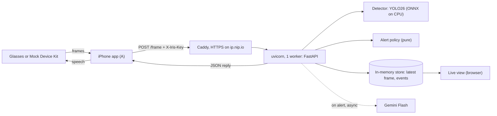
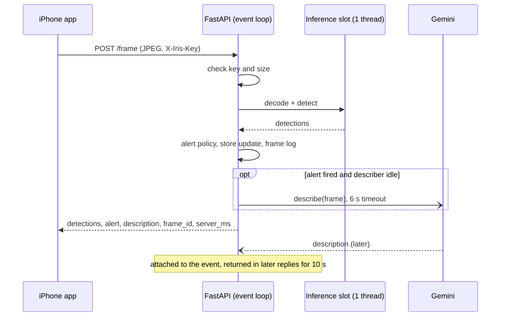

# Iris server and infra: system design

Owner: Person B · Status: draft, input for `/grill-with-docs` · Oct 16, 2026

This doc covers everything B owns: the FastAPI server, alert logic, live view, Gemini descriptions and the Vultr deploy. It is written to be grilled, turned into a spec with `/to-spec`, and split into tickets with `/to-tickets`. Section 14 lists the tickets, section 15 covers small PRs and reverts, and section 16 covers how to run the tickets through the agent workflow.

## 1. Summary

- One FastAPI process, one uvicorn worker, all state in memory. No database.
- Only inference leaves the event loop. It runs in a single worker-thread slot, and all state changes happen back on the event loop, so state has exactly one writer and needs no locks.
- The alert policy is a pure function. It fires on 2 hits in the last 3 frames, with a 4 s cooldown and a 10 s same-side repeat limit. It is tested only through `POST /frame`, using a fake detector and a fake clock.
- Gemini runs after an alert, in the background, with a timeout. A spoken alert never waits on it.
- Every single point of failure has a fallback (section 12):
  - systemd restarts the server if it crashes.
  - A deploy rolls back if the health check fails.
  - The app fails over to the laptop URL.
  - Bad weights fall back to the stock model.
- Serving runs on a Vultr Dedicated CPU instance (8 vCPU, about $0.24/hr, so roughly $10 for the whole event) with YOLO exported to ONNX, behind Caddy with automatic HTTPS on a `nip.io` hostname. Vultr's GPU plans in the console are either unavailable or far over budget. The laptop is a fallback, one URL change away in the app.

## 2. Priorities and non-goals

This is a hackathon server: one phone, one server, about 36 hours. When two choices conflict, the higher priority wins.

1. **Working.** The `/frame` contract works at every checkpoint. Alerts feel right: about a second from a person appearing to speech, with no spam.
2. **Resilient and reliable.** It stays up through judging, recovers from crashes on its own, and every single point of failure has a fallback you have practiced (section 12, "Failure modes").
3. **Secure.** Nothing reachable from the internet can be abused cheaply: no open write endpoints, no plaintext traffic, no leaked keys (section 12, "Security checklist").
4. **Fast.** Frame to speech under 1 s over cellular, and nothing slow on the frame path.

Supporting goals: tune thresholds without rebuilding the app or restarting the server, and produce real numbers for the pitch (server latency, end-to-end latency, alerts per clip).

**Non-goals**

- **Scale.** One phone streams at a time, so there is one alert stream, and that assumption is recorded as an ADR. No load balancing, autoscaling or multiple workers.
- Persistence beyond log files, user accounts, and horizontal scaling.
- Object tracking (ByteTrack). This can be revisited after hour 16 if the 2-of-3 window still spams.
- Training. That belongs to C.

## 3. API contract

The team plan's contract is unchanged. This design only adds optional fields and one header. iOS `Codable` decoding ignores keys it doesn't know, so the added fields can't break A's app. A must still agree to the header, because the team rule is to talk before any contract change.

### `POST /frame`

The request is multipart, with a field `file` holding a JPEG (640 px wide, quality 70).

**New:** if the server has `IRIS_API_KEY` set, the request must carry an `X-Iris-Key` header. Leave the key unset for local dev.

Response `200`:

```json
{
  "detections": [{"label": "person", "conf": 0.71, "side": "left"}],
  "alert": "possible person, left",
  "description": null,
  "frame_id": 1842,
  "server_ms": 38
}
```

| Field | Status | Meaning |
| --- | --- | --- |
| `detections` | contract | Boxes at or above `CONF_DETECT` with an alert label. `side` is `left`, `ahead` or `right`. |
| `alert` | contract | The text to speak, or `null`. The server owns every rule behind it. |
| `description` | new, optional | Gemini's one sentence for the latest event less than 10 s old, else `null`. For display, not for speech. |
| `frame_id` | new, optional | Increments per frame. Lets A match app logs with server logs. |
| `server_ms` | new, optional | Time from receiving the upload to the response being ready. A subtracts it from the round trip to get network time. |

Errors use FastAPI's `{"detail": "..."}` shape. The app should treat any non-200 response as "no alert" and keep streaming.

| Code | When |
| --- | --- |
| 400 | The body is not a decodable image, or its sides are larger than 4096 px. |
| 401 | The key is missing or wrong, when a key is configured. |
| 413 | The body is over 2 MB. |
| 503 | The model hasn't finished loading yet. |

### Keeping the app and server compatible

Either side's PRs must be revertable without breaking the other side.

- **Fixtures are the contract.** `docs/contract/*.json` holds example replies. Server tests check that real replies match their shape, and A can decode the same files in a Swift unit test. A contract change means changing a fixture, labeled as a contract change and reviewed by A.
- **Additive only.** The server can add optional fields, headers or endpoints. It never renames or removes any.
- **Tolerant reader in Swift:**
  - Decode `label` and `side` as `String`, not as a strict `enum`. If C adds a class like `limb`, a strict enum would fail to decode the whole reply, and alerts would go silent.
  - Make every new field `Optional`.
  - Treat a decode failure the same as a non-200: no alert, log it, keep streaming.
  - `frame-extended.json` includes an unknown `future_field` to prove this works.
- **Order cross-side changes as expand, then contract:**
  - A new field in the reply ships on the server first. The app starts reading it later.
  - A new requirement on the request, like the key header, ships in the app first. The server enforces it later, by setting `IRIS_API_KEY`.
  - Done in that order, reverting either step leaves both sides working.

### Other endpoints

| Method and path | Auth | Purpose |
| --- | --- | --- |
| `GET /health` | none | Readiness, active model, device, labels, image size, fps, server ms p50/p95, git commit, tuning |
| `GET /` | none | Live view page |
| `GET /latest.jpg` | none | The last frame received, as raw JPEG |
| `GET /latest` | none | `frame_id`, detections with normalized boxes, and the time the frame arrived |
| `GET /events?since=<id>` | none | Recent events: id, time, side, conf, description |
| `GET /tuning` | none | The current tuning values |
| `PUT /tuning` | key | Changes tuning at runtime. Validated, kept in memory, reset to env defaults on restart. |

The read endpoints are open, so anyone with the URL can see the camera feed. If that matters during judging, require the same key on them as a `?key=` query parameter.

## 4. Glossary

These terms are candidates for `GLOSSARY.md`; `/grill-with-docs` should settle them.

- **Frame**: one JPEG the app posts to `/frame`.
- **Detection**: one box from the detector, kept only if its label is an alert label and its conf is at least `CONF_DETECT`.
- **Hit**: a detection with conf at least `CONF_ALERT`. A **hit frame** has at least one hit.
- **Window**: the hit flags of the last `WINDOW` frames received within `WINDOW_MAX_AGE_S`.
- **Side**: `left`, `ahead` or `right`, from which third of the frame the box center falls in.
- **Alert policy**: the rules that turn the window into an alert.
- **Alert**: the text returned in `alert`.
- **Cooldown**: the minimum time between any two alerts.
- **Same-side repeat**: the minimum time between two alerts on the same side.
- **Event**: the record of a fired alert: id, time, side, conf, frame and, later, a description.
- **Description**: Gemini's one-sentence summary of an event's frame.
- **Detector**: an adapter from an image to detections. YOLO is one, and D's zero-shot model is another.
- **Describer**: an adapter from a frame to a description (Gemini).
- **Tuning**: the alert policy parameters that can change at runtime.
- **Live view**: the browser page showing the latest frame, boxes and the event log.
- **Replay harness**: a script that streams a video clip to the server the way the app does.

## 5. Architecture



### Module map

The team plan gives B `main.py`, `config.py` and `gemini.py`. This design proposes that B owns all of `server/` except `zeroshot.py` (D) and `weights/` (C). Update the plan's ownership table when you agree on that.

| Module | Responsibility | Depends on |
| --- | --- | --- |
| `server/domain.py` | Types: `Box`, `Detection`, `Side`, `Event`, `Tuning`, `PolicyState` | stdlib only |
| `server/alerts.py` | Alert policy: `decide(state, detections, now, tuning) -> (state, alert or None)` | `domain` |
| `server/detector.py` | `Detector` protocol, plus the YOLO adapter (device, warmup, normalized boxes) | `domain`, ultralytics |
| `server/zeroshot.py` (D) | Zero-shot `Detector` that implements the same protocol | `domain`, transformers |
| `server/gemini.py` | `Describer` protocol, plus the Gemini adapter (prompt, timeout) | google-genai |
| `server/store.py` | Latest frame snapshot, event ring buffer (200 events), rolling latency stats, JSONL logs | `domain` |
| `server/pipeline.py` | Per frame: decode and detect in the worker slot, then policy, store and describe on the loop | everything above |
| `server/config.py` | `Settings`, parsed from the environment once at startup | pydantic-settings |
| `server/routes/*.py` | Thin HTTP layer: `frame`, `live`, `admin` (tuning) | `pipeline`, `store` |
| `server/main.py` | `create_app(detector, describer, clock, settings)`, lifespan, router wiring | all |
| `server/static/live.html` | Live view: polls `/latest`, `/latest.jpg` and `/events`, draws boxes on a canvas | HTTP only |
| `server/scripts/replay.py` | Replay harness | HTTP only |
| `deploy/` | `bootstrap.sh`, `update.sh`, `iris.service`, `Caddyfile` | |

Rule: `domain`, `alerts` and `store` never import FastAPI, ultralytics or genai. Validation and parsing happen at the boundaries (`routes`, `config`, adapters). Inside them, code trusts its types.

Run commands from `server/` (`uvicorn main:app`), as in the team plan, so D's `zeroshot.py` imports as a sibling module.

### Type shapes

These came from a prototype of the policy that passes every scenario in section 13.

```python
Side = Literal["left", "ahead", "right"]

@dataclass(frozen=True)
class Box: x1: float; y1: float; x2: float; y2: float   # normalized 0..1

@dataclass(frozen=True)
class Detection: label: str; conf: float; box: Box      # side is derived from box center x

@dataclass(frozen=True)
class Tuning:
    conf_alert: float = 0.35; window: int = 3; needed: int = 2
    cooldown_s: float = 4.0; same_side_repeat_s: float = 10.0; window_max_age_s: float = 2.0

@dataclass(frozen=True)
class PolicyState:
    recent: tuple[tuple[float, bool], ...] = ()          # (time, hit) pairs
    last_alert_at: float | None = None
    last_alert_side: Side | None = None

class Detector(Protocol):
    name: str
    def detect(self, image: np.ndarray) -> list[Detection]: ...

class Describer(Protocol):
    async def describe(self, jpeg: bytes) -> str: ...

class Clock(Protocol):
    def now(self) -> float: ...                           # monotonic seconds
```

`Tuning` validates `1 <= needed <= window` and `0 < conf_alert <= 1`, both at startup and on `PUT /tuning`. That makes an impossible policy unrepresentable.

## 6. Frame lifecycle



1. **Auth.** If a key is configured, compare `X-Iris-Key` against it with `hmac.compare_digest`. Return 401 if it doesn't match.
2. **Size.** Caddy caps request bodies at 2 MB and the app enforces the same limit again, returning 413.
3. **Decode and detect** run in a worker thread through `anyio.to_thread.run_sync` with a `CapacityLimiter(1)`. The model is a real single-writer resource, so that's the one place work is serialized. Decoding uses `cv2.imdecode`; a failure, or a side over 4096 px, returns 400. The pipeline, not the adapter, then keeps only detections whose label is in `ALERT_LABELS` (just `person` for the stock COCO model) and whose conf is at least `CONF_DETECT`. That keeps the filter testable with a fake detector.
4. **Side** comes from the box center x: left if below 1/3, right if above 2/3, otherwise ahead.
5. **Alert policy** runs on the loop (section 7).
6. **Store**: replace the latest-frame snapshot (raw JPEG bytes, detections, frame_id, time), update the latency stats, and append one line to `logs/frames.jsonl`. If an alert fired, append an event to the ring buffer and to `logs/events.jsonl`.
7. **Describe**: if an alert fired and no description is already running, start a background task. Hold a reference to the task in a set so it isn't garbage-collected. On success, write the description onto that event. The event loop is still the only writer.
8. **Respond** with the latest event's description if the event is less than 10 s old.

**Why it's built this way:** an `async def` route that called the model directly would block the event loop, which is exactly what `fastapi-reviewer` flags. A plain `def` route runs in a thread pool, and then state would have many writers. Sending only the blocking call to one slot avoids both problems.

### Latency budget

These are estimates. Measure them with the replay harness and `/health`.

| Step | Laptop on LAN | Vultr over cellular |
| --- | --- | --- |
| App resizes and encodes the JPEG (A) | 10–20 ms | 10–20 ms |
| Upload of about 50 KB | 20–50 ms | 100–300 ms |
| Decode | ~3 ms | ~3 ms |
| YOLO26s at 640 | Laptop GPU: well under 20 ms | Vultr CPU with ONNX: about 90–150 ms |
| Policy, store, serialize | <1 ms | <1 ms |
| Reply and start of speech | 50–100 ms | 100–200 ms |
| **Frame to speech** | **< 0.3 s** | **< 0.8 s** |

**Speed rules:**
- **Reuse one connection.** A uses a single `URLSession` for every upload, so the connection and TLS handshake are set up once. A new handshake per frame would add 100–300 ms over cellular.
- **Small uploads.** Frames stay at about 50 KB.
- **Nearby server:** Atlanta region.
- **Warm model.** The model warms up at startup, so the first frame isn't slow.
- **Nothing slow on the frame path.** Gemini runs in the background, boxes are drawn in the browser, and the server writes one log line per frame.

The first alert can't fire before the second hit frame, about 0.4 s after the first at 2.5 fps. So a person entering view is announced roughly 1 s later on the LAN, and a bit more over cellular.

## 7. Alert policy

These rules are exact; the tests in section 13 come from them.

1. A **hit** is a detection with an alert label and conf at or above `conf_alert`.
2. The **window** is the last `window` frames whose timestamps are within `window_max_age_s` of now, including the current frame. Older entries are dropped, so hits from before a pause in the stream don't count.
3. An alert fires only on a hit frame, and only when the window holds at least `needed` hits.
4. It is suppressed if the time since the last alert is under `cooldown_s`.
5. It is also suppressed if the time since the last alert is under `same_side_repeat_s` and the side is the same as last time.
6. The side is the side of the highest-confidence hit in the current frame.
7. The text is `possible person, <side>` for every alert label.

**Changes from the team plan**

- **2 of the last 3 frames** instead of 2 in a row. At 2.5 fps, a single dropped detection, from a head turn or a raindrop, would otherwise reset the streak. The plan's rule is still available as `needed = window = 2`.
- **Same-side repeat.** Without this, a person who stays in view gets announced every 4 s. A new person on another side is still announced after the 4 s cooldown.
- **Server clock**, read through an injected monotonic `Clock`. The phone's clock is never used.

The defaults are starting points. Tune them at Checkpoint 3 with `PUT /tuning` while the replay harness runs.

## 8. Gemini descriptions

- **Trigger:** only on a fired alert, and only if no description is already running. The cooldown already limits calls to at most one every 4 s.
- **Input:** the JPEG of the frame that fired the alert.
- **Prompt:** one sentence, at most 20 words, for a rescuer: how many people are visible, how exposed they are, and hazards nearby. It should hedge rather than claim certainty, and answer "unclear" if no person is visible.
- **Model:** set by `GEMINI_MODEL`, using a current Flash model from AI Studio. The key is in `GEMINI_API_KEY`. `DESCRIBE=off` disables descriptions entirely.
- **Failure:** after a 6 s timeout, an API error or an empty reply, the description stays `null` and the server logs a warning. `/frame` is never affected.
- **Use:** A shows the description on the status screen, and the live view shows it next to the event. It is never spoken, since that would delay the next alert.

## 9. Live view

- `GET /` serves `static/live.html`, with no build step and no framework.
- It polls `/latest.jpg` and `/latest` about every 300 ms and draws the boxes on a canvas from normalized coordinates. Each box shows its label and conf, and hits are colored differently from detections below `conf_alert`.
- It polls `/events` every second for the alert log: time, side, conf and description.
- A header strip shows the model, device, incoming fps, p50/p95 server ms, seconds since the last frame, and the current tuning.
- **Change from the plan:** the plan had the server draw boxes onto the image. Drawing them in the browser keeps that work out of the frame path, and the same page serves as the "command center" in the demo.

## 10. Concurrency and state

- **One process and one uvicorn worker.** More workers would each load the model and split the alert state.
- **Single writer.** All state lives on the event loop. The inference slot only computes and returns values. Readers get immutable snapshots, because the store replaces whole frozen objects instead of mutating them.
- **Backpressure.** The app sends one frame at a time and skips frames while a request is in flight (A's `FrameUploader`). The server doesn't drop frames. If two clients ever post at once, they queue on the slot.
- **Restart** clears tuning and events. The JSONL logs survive.

## 11. Models

- **Startup:** the lifespan handler loads `MODEL_PATH` in a thread and runs one warmup inference on a blank image, so the first real frame isn't slow. `/frame` returns 503 until this finishes.
  - If `MODEL_PATH` is missing or fails to load, the server logs loudly, falls back to `yolo26s.pt`, and reports the fallback in `/health`.
- **Device:** CUDA if available, then MPS on a Mac, then CPU. `DEVICE` overrides this.
- **Swapping in C's weights is a config change, not a PR:**
  - C hands over versioned files that are never overwritten: `iris-v1.onnx`, `iris-v2.onnx`, and so on. Each comes with a note of its class names, image size and SHA-256.
  - To switch, set `MODEL_PATH`, `ALERT_LABELS` (for example `person,limb`) and `IMGSZ`, then restart. That takes about 5 s under systemd.
  - To roll back, point `MODEL_PATH` at the previous file and restart.
  - Agree the class names with C before C's first training run.
- **Startup label check:** if none of `ALERT_LABELS` appear in the model's class names, the server logs loudly and falls back to stock `yolo26s`. Without this check, renamed classes would silently filter out every detection, and alerts would just stop. `/health` shows the model file, its SHA-256 and its class names.
- **Zero-shot fallback:** D's `zeroshot.py` implements `Detector`, and `DETECTOR=zeroshot` selects it. It needs a GPU to keep up with the stream, so it can only run live on a laptop, not on the Vultr CPU box. Measure its latency before relying on it.
- **Serving on CPU (Vultr):** export each model to ONNX with `model.export(format="onnx", nms=False)` and point `MODEL_PATH` at the `.onnx` file. Ultralytics lists YOLO26s at about 87 ms per image on CPU with ONNX at 640 px; check that number on the instance. On CPU, stay at `yolo26s` and 640 px. YOLO26m is listed at about 220 ms at 640 px, and a 960 px input would be slower still.

## 12. Infra

### Environments

| Environment | Where | URL for A | When |
| --- | --- | --- | --- |
| Dev | Your laptop: `uvicorn main:app --host 0.0.0.0 --port 8000 --reload` | `http://<laptop-ip>:8000` | Hours 0–16 |
| Primary | Vultr Dedicated CPU behind Caddy | `https://<ip-with-dashes>.nip.io` | From hour 12 for testing, then for judging |
| Fallback | Laptop with a phone hotspot, running the same commit | `http://<laptop-ip>:8000` | If Vultr fails |

A's app has an editable server URL, so switching takes one paste. Practice the switch once before judging.

### Vultr choice

- **Credits:** $100 per person through MLH. Each person can register once, at mlh.link/vultr-discover.
- **Serving: Dedicated CPU, CPU Optimized plan, 8 vCPU, 16 GB RAM.** Vultr's pricing page lists it at $0.238/hr, so 40 hours costs about $10. YOLO26s as ONNX at 640 px handles 2–3 fps easily. If that exact plan isn't offered, any 8 vCPU dedicated plan works.
- **Why not a GPU:** in the console, the only A16 plan is 16 GPUs at $7.53/hr, and it's unavailable in every location. Even if it were available, $100 would last about 13 hours on it. The pricing page lists a single L40S at $1.67/hr; if one is available, you could rent it for just the judging window (6 hours is about $10). The CPU box stays the default.
- **Training** runs on Colab or a laptop GPU, not on Vultr. A CPU box is too slow to train on.
- **Region:** Atlanta or Miami, closest to Gainesville.
- **Image:** Ubuntu LTS. Install the CPU build of PyTorch before ultralytics with `pip install torch torchvision --index-url https://download.pytorch.org/whl/cpu`. Otherwise pip pulls the multi-GB CUDA build. Then run `pip install ultralytics onnxruntime`.
- **Firewall group:** inbound 22 from your IP only, and 80 and 443 from anywhere. Port 80 is needed for Let's Encrypt. Port 8000 stays closed.

### HTTPS

- Caddy reverse-proxies `<ip-with-dashes>.nip.io` to `127.0.0.1:8000` and gets a Let's Encrypt certificate automatically. This needs no domain purchase.
- **Why bother:** iOS won't block plain HTTP to a raw IP, because ATS isn't applied to requests that target an IP address on iOS 10 and later. But without HTTPS, the camera frames and the API key would cross the network unencrypted. Apple also warns that raw IPs can break on IPv6-only networks, and some US cellular networks are IPv6-only.
- The team plan has A add `NSAllowsLocalNetworking`. That covers the laptop and doesn't need to change.

### Deploy files

`deploy/` holds these files. Every script can be re-run safely, ending in the same state.

- **`bootstrap.sh`**, run once as root:
  1. Install git, python3-venv and Caddy (from Caddy's official apt repo).
  2. Create an `iris` user.
  3. Clone the repo to `/opt/iris` (use a read-only deploy key, since the repo is private), or pull it if it's already there.
  4. Create the venv if it's missing and install `server/requirements.txt`.
  5. Copy `.env.example` to `/etc/iris.env` only if that file doesn't exist yet.
  6. Write the Caddyfile with this box's public IP filled in.
  7. Install and enable both services, then curl `/health`.
- **`update.sh <ref>`**:
  1. Record the current commit, then check out `<ref>` (a branch, tag or commit).
  2. Run `pip install -r` (a no-op when nothing changed) and `systemctl restart iris`.
  3. Wait up to 60 s for `/health` to report ready.
  4. If it never does, check out the previous commit, restart, and exit non-zero.
  
  After feature freeze, tag the commit `demo` and deploy only that tag. The laptop runs the same tag.
- **`iris.service`**:

```ini
[Service]
User=iris
WorkingDirectory=/opt/iris/server
EnvironmentFile=/etc/iris.env
ExecStart=/opt/iris/.venv/bin/uvicorn main:app --host 127.0.0.1 --port 8000 --workers 1
Restart=always
RestartSec=2
NoNewPrivileges=true
PrivateTmp=true
```

- **`Caddyfile`**:

```
203-0-113-5.nip.io {
	request_body {
		max_size 2MB
	}
	reverse_proxy 127.0.0.1:8000
}
```

- **Weights** never go in git. Use `scp best.pt iris@<ip>:/opt/iris/server/weights/`, or download them from the shared Drive folder.

### Teardown

Vultr bills an instance until it is destroyed, even while it's stopped. Teardown is automatic, so forgetting can't burn the credits.

- **Label** the instance `iris-server` when you create it. The teardown only touches instances with exactly that label.
- **`deploy/teardown.sh`**:
  1. Lists instances through the Vultr API and destroys each one labeled `iris-server`.
  2. Waits, lists again, and exits non-zero if any are left.
  
  `DRY_RUN=1` only prints what it would destroy.
- **`.github/workflows/vultr-teardown.yml`** runs the script on a schedule from GitHub's servers, not from the Vultr box, so the Vultr API key never sits on a machine exposed to the internet.
  - It runs every 6 hours from 00:00 UTC Oct 19 (8 pm Oct 18 in Gainesville) through Oct 31. Later runs catch anything an earlier run missed.
  - A failed run emails you.
  - It also has a manual button that defaults to a dry run.
- **Setup:**
  1. In Vultr, go to Account > API, enable the API and copy the key. Check its access-control list: GitHub's runners use changing IPs, so their calls are rejected unless all IPv4 addresses are allowed for the weekend.
  2. Put the script and workflow in a small private repo of your own, not in `iris`, and save the key there as the repository secret `VULTR_API_KEY`. That keeps the key and the schedule away from the team repo.
  3. Run the workflow by hand with dry run on, and confirm it lists your instance.
- **After judging,** run it by hand with dry run off. The schedule is the safety net. GitHub can start scheduled runs late, so the manual run is the real teardown.

### Config

Everything comes from the environment. `.env.example` is committed; `.env` and `/etc/iris.env` never are.

```
MODEL_PATH=weights/best.pt
DETECTOR=yolo
ALERT_LABELS=person
IMGSZ=640
DEVICE=
CONF_DETECT=0.25
CONF_ALERT=0.35
WINDOW=3
NEEDED=2
COOLDOWN_S=4
SAME_SIDE_REPEAT_S=10
WINDOW_MAX_AGE_S=2
IRIS_API_KEY=
DESCRIBE=on
GEMINI_API_KEY=
GEMINI_MODEL=
GEMINI_TIMEOUT_S=6
MAX_UPLOAD_BYTES=2000000
```

### Failure modes

| What fails | What happens | Recovery |
| --- | --- | --- |
| The server process crashes | systemd restarts it within about 2 s | Automatic. The app's next frame succeeds. |
| A request hangs | The app's 1.5 s timeout drops it and the next frame goes out | Automatic (A) |
| A bad deploy | `update.sh` sees `/health` never report ready | Automatic rollback to the previous commit |
| C's weights fail to load | The server falls back to stock `yolo26s` and `/health` says so | Automatic. Fix and redeploy. |
| Gemini is slow or down | `description` stays `null` | Automatic. Alerts are unaffected. |
| The Vultr box or its network goes down | Requests time out | The app switches to the fallback URL after 3 failures in a row (A) |
| Venue wifi goes down | The phone uses cellular to reach Vultr | The laptop fallback runs on a phone hotspot |
| The TLS certificate can't be issued | Caddy keeps retrying | Get the certificate by hour 12, long before judging. Worst case, use the laptop. |
| The fallback laptop sleeps | The fallback URL is dead when needed | Keep it plugged in with sleep off (`caffeinate` on a Mac) |
| The instance is forgotten after the event | It keeps billing even while stopped, about $170 a month on the 8 vCPU plan | The scheduled teardown destroys it (see "Teardown") |

### Security checklist

**Transport and exposure**
- [ ] TLS through Caddy. uvicorn listens on `127.0.0.1` only.
- [ ] Firewall: SSH from your IP only, plus 80 and 443.
- [ ] SSH key login only. Add your key when you deploy and set `PasswordAuthentication no`.

**Endpoints**
- [ ] `X-Iris-Key` on `POST /frame` and `PUT /tuning`, compared in constant time.
- [ ] Optionally, the same key as a `?key=` parameter on the read endpoints, since they show the camera feed.
- [ ] A 2 MB body cap at Caddy and in the app, a 4096 px decode guard, and 400 for anything that isn't an image.
- [ ] No file paths or pickles from requests. Weights load only from the server's disk.

**Process and secrets**
- [ ] The service runs as the `iris` user with `NoNewPrivileges`, not as root.
- [ ] Secrets live only in `/etc/iris.env` (mode 600) and local `.env` files. Only `.env.example` is committed.
- [ ] Gemini can't be run up by strangers: it only fires on keyed requests, at most once per cooldown. Set a usage cap in AI Studio anyway.

**After the event**
- [ ] Confirm the teardown workflow destroyed the instance. A stopped instance still bills.
- [ ] Revoke the Vultr API key, the Gemini key and the deploy key.

### Judging runbook

1. **30 minutes before:**
   - Run `scripts/replay.py --preflight` against both Vultr and the laptop. It checks `/health` (ready, model, commit) and plays one short clip against its `--expect` file. Both should print PASS on the `demo` tag.
   - Open the live view on the laptop.
2. **During:** watch p95 server ms and the age of the last frame. The app fails over on its own. If it hasn't and replies are slower than 1 s, A pastes the laptop URL.
3. **After each judge:** check the live view's event log for spam, and nudge the tuning if needed.

## 13. Testing

There are two seams, to be confirmed in `/to-spec`.

1. **The HTTP API** is the primary seam. Tests go through `create_app(...)` with httpx `TestClient`, injecting a `FakeDetector` (scripted detections per call), a `FakeClock` (advanced by hand) and a `FakeDescriber` (returns text, raises, or sleeps past the timeout).
   - Frames are real JPEG bytes, so decoding is real.
   - This seam covers the contract shape, the alert policy, errors, events, descriptions and tuning.
   - No test reaches into `alerts.py` or `store.py` directly, so both can be rewritten freely.
2. **The real artifact.** The replay harness runs against a running server with the real model and D's demo clips. This is gate 5 of the `verify` skill.
   - It reads a clip, samples it at 2.5 fps, resizes to 640 px wide, encodes JPEG at quality 70, and posts one frame at a time, matching the contract.
   - It prints each alert with its clip time, then fps and server and round-trip p50/p95.
   - With `--expect clip.json` (D's time windows when a person is visible), it prints pass or fail. Every window must get an alert within 2 s of starting, and no alert may fire outside a window plus a 1 s grace period.

There is also one smoke test with the real model: post `tests/fixtures/person.jpg` and get at least one person detection. It is skipped when the weights are missing.

### Worked scenarios

The expected values come from the rules in section 7, not from the code, and a prototype of the policy reproduced each one. Defaults apply, with frames every 0.4 s. "Hit" means a person at conf 0.6 on the left, unless stated otherwise.

| # | Frames | Expected |
| --- | --- | --- |
| 1 | Hits at 0.0 and 0.4 | Alert at 0.4: `possible person, left` |
| 2 | Hit, miss, hit at 0.0, 0.4, 0.8 | Alert at 0.8 |
| 3 | Hit, miss, miss, hit at 0.0 to 1.2 | No alert |
| 4 | Conf 0.30 every frame | Detections returned, no alert |
| 5 | Hit on the left every frame from 0.0 to 15.6 | Alerts at 0.4 and 10.4 only |
| 6 | Left hits at 0.0 and 0.4, misses, then right hits (conf 0.8) from 2.0 | Left at 0.4, right at 4.4 |
| 7 | Hit at 0.0, a pause, then hits at 5.0 and 5.4 | Alert at 5.4 only |
| 8 | Box centers at x = 0.10, 0.50, 0.90, 1/3, 2/3 | left, ahead, right, ahead, ahead |
| 9 | Left 0.6 and right 0.8 in the same frames, at 0.0 and 0.4 | Alert at 0.4 on the right |
| 10 | Empty clip | No alerts |
| 11 | A `car` at conf 0.9 every frame (stock model) | No detections and no alerts |
| 12 | Gemini sleeps past the timeout | `/frame` replies normally and `description` stays `null` |
| 13 | Non-image body, 3 MB body, wrong key | 400, 413, 401 |

## 14. Tickets

These are tracer-bullet slices for `/to-tickets`. Each one is demoable on its own.

| # | Ticket | Blocked by | Done when |
| --- | --- | --- | --- |
| 01 | **Walking skeleton.** `/frame` returns the contract JSON from stock YOLO26 (person only), plus `/health`, `create_app` with injectable dependencies, pyproject, ruff, mypy and pytest. | none | The team's curl test and the app's first POST both get JSON. This is **Checkpoint 1**. |
| 02 | **Alert policy.** Window, cooldown, same-side repeat and side, tuned from config. | 01 | Scenarios 1–11 pass at the HTTP seam. |
| 03 | **Replay harness and latency logs.** `frames.jsonl`, plus p50/p95 in `/health`. | 01 | The harness prints alerts and latency for one of D's clips against the laptop, and `--preflight` prints PASS or FAIL. |
| 04 | **Hardening and key.** Size cap, decode guard, `X-Iris-Key`. | 01 | Scenario 13 passes, and A's app sends the key. |
| 05 | **Vultr deploy.** Bootstrap, systemd, Caddy, `update.sh` with rollback, ONNX model on CPU, security checklist. | 01, 04 | The harness passes against the https URL with server p95 under 200 ms, the app works over cellular, killing the process recovers in about 2 s, a deliberately broken commit rolls back by itself, and a dry run of the teardown workflow lists the instance. Start early (hour 3–12), as the plan says. |
| 06 | **Live view and events.** `/latest`, `/latest.jpg`, `/events` and the page. | 02 | A mock clip from the app shows boxes and the event log. This is **Checkpoint 2**. |
| 07 | **Detector swap.** C's `best.pt`, label mapping, fallback to stock, and the zero-shot hook. | 01 | `/health` shows C's model, the harness shows its alerts, and deleting the weights falls back cleanly. |
| 08 | **Gemini descriptions.** Async on alerts, in `/frame`, `/events` and the live view. | 02, 06 | Scenario 12 passes, and a real alert shows a description within about 3 s. |
| 09 | **Runtime tuning.** `GET`/`PUT /tuning` plus controls in the live view. | 02, 04, 06 | You can tune during a harness run without a restart. Used for **Checkpoint 3**. |

**Waves**

1. **Wave 1:** 01.
2. **Wave 2:** 02, 03 and 04, in parallel.
3. **Wave 3:** 05, 06 and 07. Ticket 04 is small, so the deploy still lands in the plan's hour 3–12 window.
4. **Wave 4:** 08 and 09.

Each route group has its own module, so `main.py` only gains one `include_router` line per ticket. That makes merge conflicts trivial for the merger subagent.

**Cut order** if you fall behind (matching the team plan): 09, then 08, then 05 (stay on the laptop with a hotspot). Never cut 01, 02 or 03.

## 15. Small PRs and reverts

Every ticket lands on `main` as its own small, squash-merged PR. Each PR is then one commit that `git revert` can undo cleanly. These rules are for B's own PRs (`server/` and infra). Teammates keep their own workflow.

### Rules

1. **One ticket and one area per PR.** B's areas are `server/`, infra and dependencies. B never touches `app/` or `training/`, so either side can be reverted alone. The PR description states the area; `CLAUDE.local.md` tells the `pr` skill to include it.
2. **Aim for under about 300 changed lines,** not counting tests and fixtures. If a ticket runs bigger, split it.
3. **Dependency changes go in their own PR,** with exact `==` pins. The server has three requirement files:
   - `requirements.txt`: the web stack.
   - `requirements-ml.txt`: ultralytics and onnxruntime. Install CPU torch first.
   - `requirements-dev.txt`: `requirements.txt` plus the test, lint and audit tools.
   
   An ultralytics or torch bump can then be reverted without touching code.
4. **Model files never go in git.** Swapping models is a config change (section 11).
5. **Contract changes are additive,** update `docs/contract/`, and need A's review (section 3).
6. **Every PR has a revert plan** in its description: a `git revert`, a kill switch, or a config rollback.
7. **CI passes before B merges.** `server-ci` runs ruff, mypy and pytest on PRs that touch `server/` or `docs/contract/`.
   - It installs only `requirements-dev.txt`, and `detector.py` imports ultralytics inside the YOLO adapter, so CI doesn't need torch and stays fast.
   - ruff and mypy exclude D's `zeroshot.py`, so D's PRs aren't held to B's lint rules.
   - The tests are unit tests with fakes, covering only B's code. The real-model check runs in the `verify` gate and on the server.
8. **Revert in reverse order.** If a later PR builds on an earlier one, revert the later one first, or fix forward behind a kill switch.

No repo settings change, so nothing changes for teammates. B picks **Squash and merge** on B's own PRs.

Don't make `server-ci` a required check. It skips PRs that don't touch `server/`, and GitHub then waits forever for a required check that never runs. That would block teammates' PRs from merging.

### PR sequence

The tickets in section 14 map one-to-one to PRs, except 01 and 05, which are split in two:

| PR | Ticket | Area |
| --- | --- | --- |
| 1 | 01a: tooling, CI, empty app factory | infra |
| 2 | 01b: `/frame` and `/health` with stock YOLO, plus contract fixtures | server, contract |
| 3 | 02: alert policy | server |
| 4 | 03: replay harness and latency logs | server |
| 5 | 04: hardening and the key check, off until `IRIS_API_KEY` is set | server |
| 6 | 05a: bootstrap, systemd, Caddy | infra |
| 7 | 05b: `update.sh` with rollback | infra |
| 8 | 06: live view and events | server |
| 9 | 07: detector swap, label check, ONNX | server |
| 10 | 08: Gemini descriptions, behind `DESCRIBE` | server, contract |
| 11 | 09: runtime tuning | server |

### When something breaks

Try the move that doesn't need git first. It's faster in the middle of a demo.

| Symptom | First move, no code change | If that's not enough |
| --- | --- | --- |
| Alerts change for the worse after a new model | Point `MODEL_PATH` back at the previous version and restart | Tell C. No revert needed. |
| No alerts at all after a new model | Check `/health` for class names; the label check should already have fallen back | Fix `ALERT_LABELS` |
| Gemini errors or slows things down | Set `DESCRIBE=off` and restart | Revert PR 10 |
| The app gets 401s | Unset `IRIS_API_KEY` and restart | Fix the app's key setting |
| The app can't decode replies after a server deploy | `update.sh <previous sha>` | `git revert` the server PR, then check the fixtures |
| A new server commit misbehaves | `update.sh <previous sha>`. A failed health check rolls back on its own. | `git revert <sha>` on `main` |
| A dependency bump breaks things | `update.sh <previous sha>` | Revert the dependencies PR |

## 16. Running this through the agent workflow

### One-time setup

The whole agent setup is personal to B. Nothing it creates is committed, so teammates' Claude sessions and PRs are unaffected.

1. Run `setup-agent-stack-local.sh` at the repo root, instead of `setup-agent-stack.sh`. It installs the same skills and agents, and differs in four ways:
   - It writes the agent workflow and the server rules to `CLAUDE.local.md`, not `CLAUDE.md`. Claude Code loads `CLAUDE.local.md` alongside `CLAUDE.md`, and subagents receive it too.
   - It lists every path it creates in `.git/info/exclude`: `.claude/`, `CLAUDE.local.md`, `.worktreeinclude`, `.scratch/`, `docs/agents/`, `docs/adr/` and `GLOSSARY.md`. That file is local to your clone, unlike `.gitignore`, so even `git add -A` skips these paths.
   - It writes `.worktreeinclude`, so implementer worktrees get the glossary, ADRs and skill config. Untracked skills and agents in `.claude/` already carry over to worktrees.
   - It warns if any of those paths are already tracked in the repo.
2. Run `/setup-matt-pocock-skills`. Choose **local markdown** and the single-context glossary, and tell it to put the `## Agent skills` block in `CLAUDE.local.md`, not `CLAUDE.md`.
3. Run `git status`. Nothing from the setup should appear.

### Per feature

1. `/grill-with-docs` with this doc. Time-box it to 15 minutes, since the doc already answers most questions. It should produce `GLOSSARY.md` from section 4, plus these ADRs:
   - The server owns the alert policy.
   - One process, in-memory state, no database.
   - 2-of-3 window, cooldown and same-side repeat.
   - Gemini runs off the frame path.
   - Serve on a Vultr Dedicated CPU box with ONNX, behind Caddy on nip.io, with the laptop as fallback.
   - A shared key on write endpoints.
2. `/to-spec`. When it asks about seams, confirm the two in section 13. The spec goes to `.scratch/iris-server/spec.md`.
3. `/to-tickets`. Check the blocking edges against section 14. Tickets go to `.scratch/iris-server/issues/`.
4. `/implement-spec`, with the override in `CLAUDE.local.md`. Implementer subagents work the frontier, each in its own worktree and test-first, and each ticket becomes its own PR to `main` instead of a commit on an integration branch.
5. Before merging each PR:
   - Run the `verify` skill, scoped to `server/`.
   - Run `/blast-radius` on anything that touches `main.py`, the contract or `pipeline.py`.
   - Run `python-reviewer` and `fastapi-reviewer` in parallel.
   - Open the PR with the `pr` skill.

### Adjustments for a hackathon

- **Ticket 01 is on the critical path for A at hour 3.** If the full workflow hasn't produced it by hour 2.5, build it by hand and run the workflow from ticket 02 on.
- **Every ticket merges to `main` as its own PR,** so A, C and D always pull a server that works, and any single change can be reverted.
- **`pip-audit`** may flag torch or ultralytics issues that have no fix yet. Record them and move on; don't let them block a wave.
- **`security-bounty-hunter`** should run once, on tickets 04 and 05, which change what the internet can reach.

## 17. Open questions for the team

1. **A:** OK to add `description`, `frame_id`, `server_ms` and the `X-Iris-Key` header? Three app-side requests for reliability and speed:
   - Use one shared `URLSession` for all uploads.
   - Set a 1.5 s timeout per request.
   - Keep a primary and a fallback server URL, switching to the fallback after 3 failures in a row and showing which one is active on the status screen.
   - Read replies as a tolerant reader (section 3): `label` and `side` as `String`, new fields `Optional`, and a decode failure treated as "no alert". Optionally, decode the `docs/contract/` fixtures in a Swift unit test.
2. **C:** What are the final class names and training image size? If C trains at 960 px, frames should arrive at 960 wide too, and that is a contract change to agree with A.
3. **D:** How fast is the zero-shot model on a laptop GPU? Is it a live fallback or offline only? Can D provide `--expect` time windows for each demo clip?
4. **Everyone:** Whose Vultr credits pay for the serving box?
